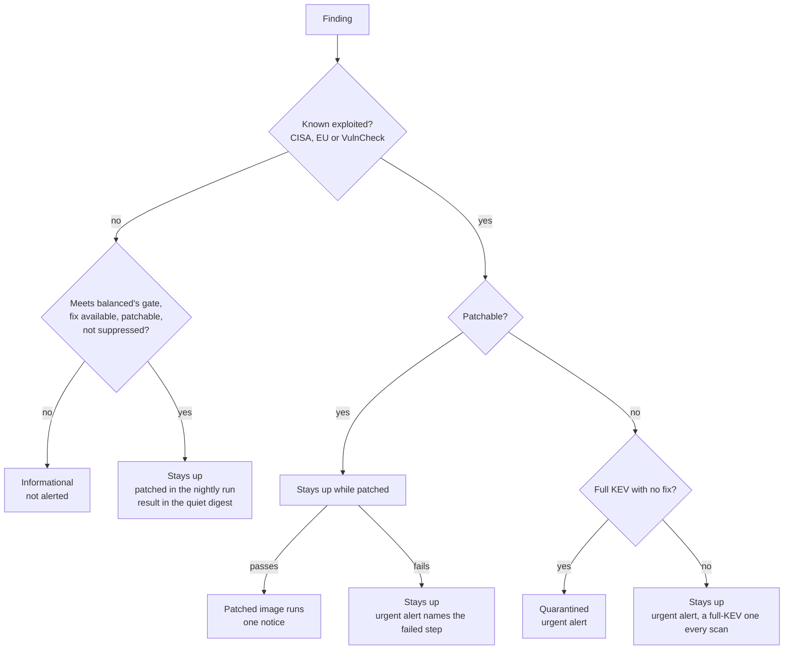
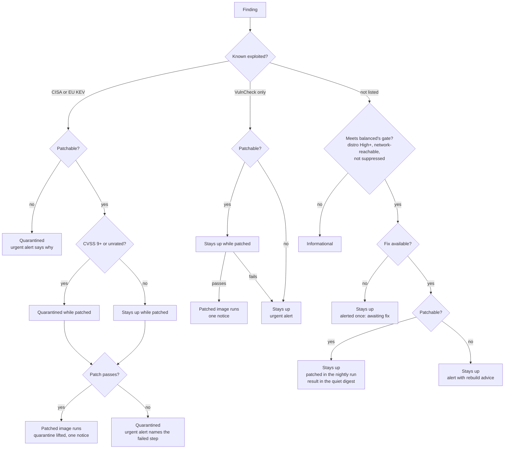
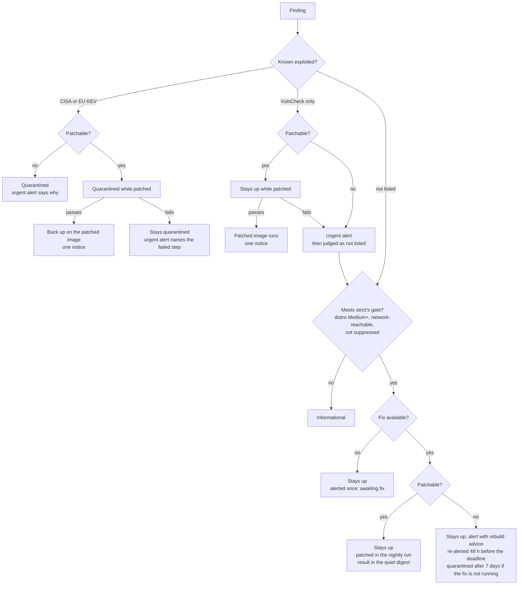
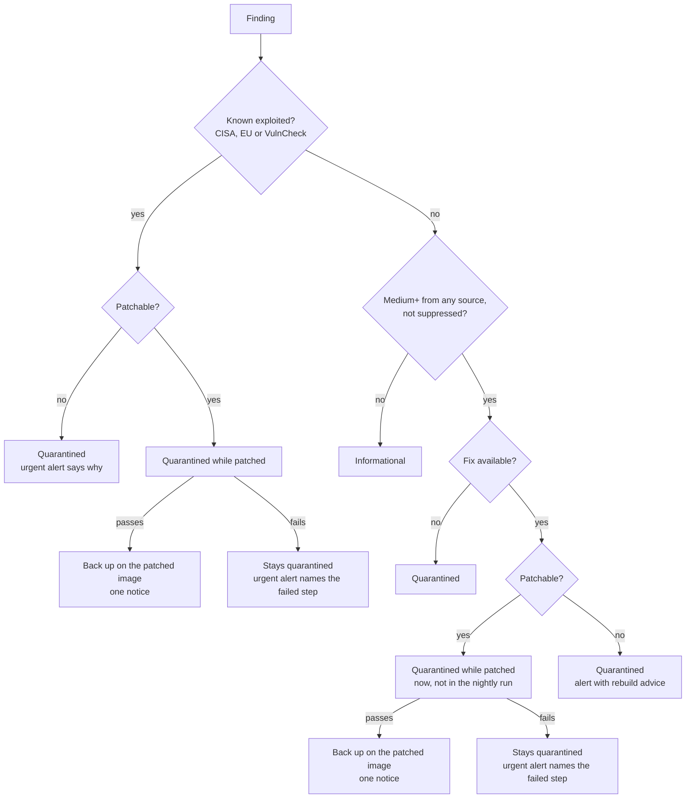
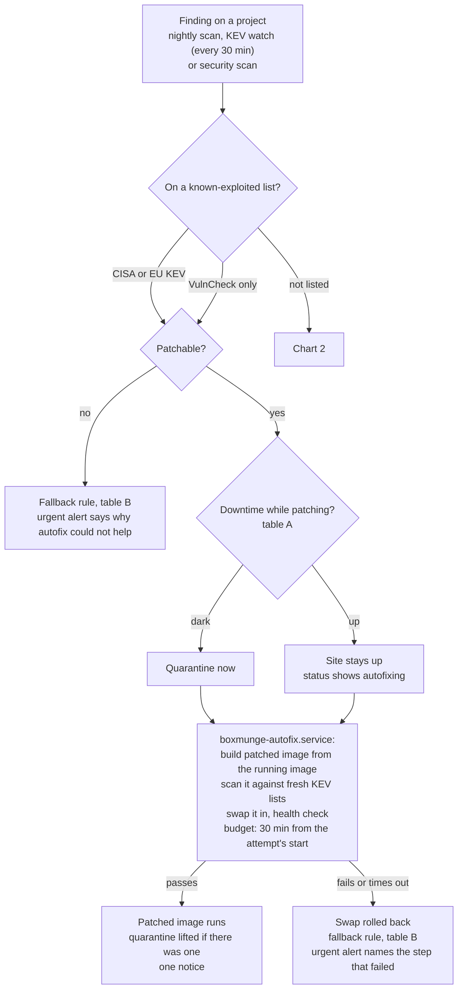
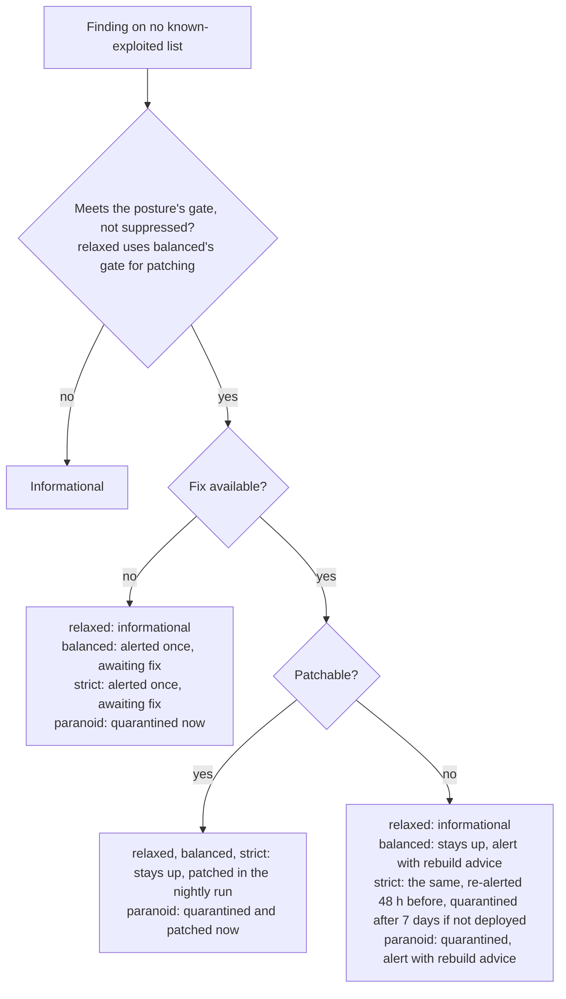
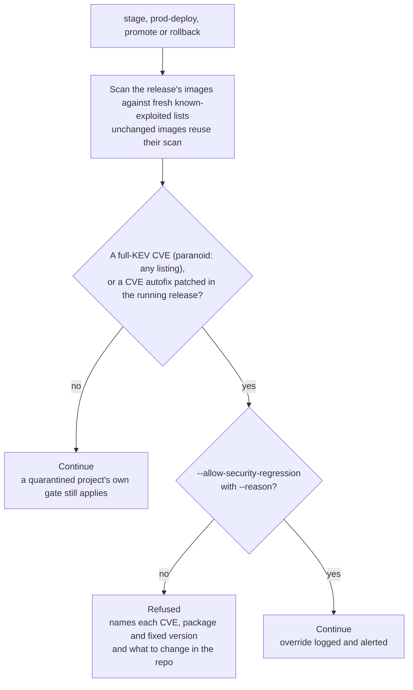
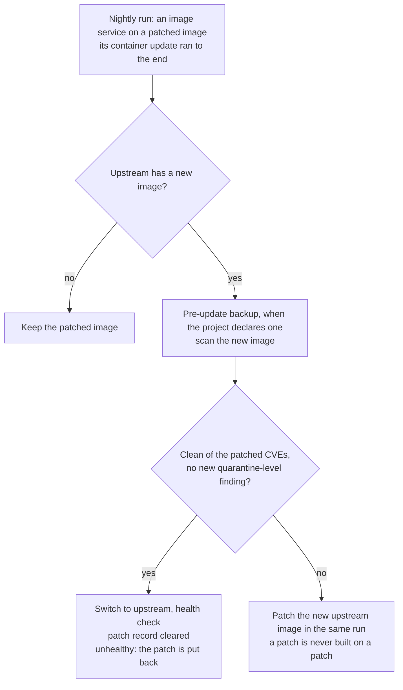

# boxmunge CVE Policy

How boxmunge handles CVEs published against deployed images: nightly
scanning, the known-exploited lists, the trust ladder, posture-based
quarantine, autofix, the deploy guard, suppression workflow, and recovery.

## Which posture should I pick?

- **`balanced`** (the default) is right for most sites. It takes a site
  down only for a CVE that is known to be exploited, and alerts on the rest.
- **`relaxed`** suits a demo or a non-production site that holds nothing
  sensitive. It takes a site down only for a CVE on CISA's or the EU's
  list that has no fix (a VulnCheck-only listing never does). Relaxed does not mean stale: autofix keeps its
  images patched (at `balanced`'s threshold, see "Autofix"), the nightly
  maintenance run keeps `image:` services on their tag's current image, and
  deploys rebuild on current base images.
- **`strict`** is for sites that handle sensitive data and want more
  protection, at the price of some risk of downtime. It alerts from Medium
  severity, and an available fix that is not deployed within 7 days takes
  the site down.
- **`paranoid`** is for small, lean services where any exposure is worse
  than downtime. Any Medium-or-worse finding from any source takes the site
  down until it is fixed. It works best with distroless or minimal images,
  where there is little for it to fire on.

Set it in the manifest under `security.posture` (see "Configuring posture").

## TL;DR for agents

- **Nightly scan via Trivy.** Every project's deployed images are scanned
  each night between 02:30 and 03:00 system time (the maintenance run, see
  "Scan cadence"), and on demand with `security scan`. The platform's own
  Caddy image is not scanned (it is not a project); container-update keeps
  it current.
- **Known-exploited lists.** CISA's KEV catalog and ENISA's EU KEV list
  (on by default) are "full KEV". VulnCheck's KEV list is opt-in and
  weaker: "VulnCheck only" alerts urgently but takes a site down only under
  `paranoid`. The KEV watch checks the lists every 30 minutes and rescans
  only the projects a newly listed CVE affects (see "Known-exploited
  sources" and "KEV watch").
- **Posture per project (default `balanced`): what are you prepared to
  accept downtime for?** `balanced` takes a site down for a full-KEV CVE,
  fixable or not; everything else is alerted, never downtime. `relaxed`
  keeps a fixable full-KEV finding up (alerted every scan). `strict` also
  takes a site down for a full-KEV CVE; it alerts from Medium, and an
  available fix not deployed within 7 days quarantines (see "Strict's fix
  deadline"). `paranoid` takes a site down for any listing, VulnCheck's
  included, and for any Medium-or-worse finding from any source, fixable
  or not, with no distro trust.
- **Autofix (on by default).** A fixable OS-package CVE is patched on the
  box: a known-exploited one at once (site down while it is patched only
  where table A says so), any other that meets the posture's gate in the
  nightly run (`paranoid` patches those at once too, site down). Each patch is built from the running image, scanned, swapped in and
  health-checked within 30 minutes, or rolled back. `status` then shows the
  project as `patched`: bring the fix into the repo before the next deploy,
  which the deploy guard otherwise refuses. Opt out with `security.autofix:
  false` (see "Autofix").
- **Trust the distro.** Below `paranoid`, the engine treats the distro's own
  triage as authoritative. A CVE the distro marked `will_not_fix`,
  `fix_deferred`, `not_affected`, or `under_investigation` is informational
  regardless of NVD severity — the distro already judged it.
- **Full KEV is an override.** A finding on CISA's or the EU's list
  quarantines immediately under every posture. The AV filter, distro
  status, severity threshold, suppressions, and a fix that is not yet
  running do not apply (under `relaxed`, a fixable full-KEV finding alerts
  every scan instead of quarantining).
- **The deploy guard.** `stage`, `prod-deploy`, `promote` and `rollback`
  scan every image the release would start, and refuse a release that
  carries a full-KEV CVE (under `paranoid`, a VulnCheck-only one too). Fix
  it in the repo; `--allow-security-regression --reason "<why>"` is the
  logged and alerted last resort (see "The deploy guard").
- **Runtime relevance gate (balanced/strict).** A finding against an OS
  package that belongs to a language runtime (`perl`, `ruby`, `php`,
  `python`, `node`, `tcl`, `lua` — the ecosystem names accepted by
  `security.runtimes`, not the OS package names) the project never invokes
  is informational, regardless of distro severity — a Python app cannot run
  a Perl regex bug. Inferred automatically from the image's own dependency
  scan; `paranoid` does not consult it, and KEV still overrides it.
- **Auto-quarantine** when a finding crosses the project's quarantine gate:
  maintenance page + `compose stop` (restart policies held at `no`) +
  priority-1 Pushover alert. **Auto-lift** (`balanced` and `strict`) when a
  later scan of every image the project starts, against fresh
  known-exploited lists, finds nothing quarantine-level and nothing on full
  KEV (see "Automatic lift").
- **No fix yet, not exploited (`balanced`, `strict`): alerted once, stays
  up.** A distro-acknowledged, network-reachable finding at the posture's
  gate (High for `balanced`, Medium for `strict`) with no fix is
  `AWAITING_FIX`: one alert says nothing needs doing now; the next comes
  when a fix lands (rebuild and redeploy) or if it is listed as exploited.
- **Suppress with operator review:**
  `boxmunge security suppress <CVE> --project <name> --until <YYYY-MM-DD> --reason <text>`.
- **Inspect state:** `boxmunge security` (fleet) or `boxmunge security <project>`
  (per-project). Both accept `--json`. A project whose manifest, scan state or
  suppressions file cannot be read is listed with the reason (`unreadable` in
  JSON, an `ERROR:` line on stderr) and the command exits 1; fix or restore
  that file rather than reading the counts as complete.
- **Recover** after a suppression with `boxmunge security resume <project>`;
  with a fix, rebuild or fix the image and `prod-deploy` it: the deploy is refused unless the new release's images clear every quarantine-level finding, and a successful deploy lifts the quarantine.
  A KEV fix the distro ships but the upstream image does not have yet can
  be built on top of that image (see "Shipping a fix the upstream image
  does not have yet").

## The promise

Sleep easy. boxmunge takes a site down only for what its posture says you
accept downtime for, and tells you about everything else.

Under the default `balanced` that is one thing: a CVE that is being actively
exploited (on CISA's Known Exploited Vulnerabilities catalog or ENISA's EU
KEV list). Then boxmunge stops the project and serves a maintenance page
before you've had your morning coffee, and the KEV watch notices a new
listing within about half an hour, not at the next nightly scan. A serious
CVE that nobody is known to be exploiting, with no fix yet, does not take
you offline: there is nothing to rebuild and nothing to do tonight. You get
one alert saying so, another when a fix lands, and the quarantine if it is
ever listed as exploited. If you would rather take downtime for unexploited
risk too, `strict` takes it for a fix left undeployed for a week, and
`paranoid` for any Medium-or-worse finding until it is fixed. Either way,
you find out.

The constraint that shaped this design: there is no AI agent on the
deployed box doing bespoke "is this exploitable in our context"
reasoning. The policy is rule-based and deterministic. Operators encode
context once, in the manifest (posture) and in suppressions (per-CVE
review notes); the engine reapplies those rules on every scan.

## The trust ladder

Each posture answers one question: **what am I prepared to accept downtime
for?** The four form a trust ladder, not just severity thresholds. The
governing insight: for every posture below `paranoid`, the distro's own
triage is a first-class, authoritative input. Debian triages CVEs against
its actual packaged versions and marks findings it judges low-risk as
`will_not_fix` or `no-dsa` — taking a site offline for those would override
the distro's own verdict without additional evidence.

`relaxed`, `balanced` and `strict` all keep that trust: at scan time the
site only goes dark for active exploitation, and `strict` adds one more
reason, a fix left undeployed past its deadline. `paranoid` is the
opposite: no distro trust and no AV filter, and the severity is the highest
any source reports, so neither the distro's triage nor a lower NVD rating
can lower it.

"Full KEV" below means listed by CISA KEV or ENISA's EU KEV; "VulnCheck
only" means listed by VulnCheck's KEV (opt-in) and by neither of the
others (see "Known-exploited sources").

| Posture | Accepts downtime for | Alerted, stays up | Severity source |
|---|---|---|---|
| **relaxed** | A **full-KEV** CVE with no fix. A fixable full-KEV finding stays up, alerted every scan. | A VulnCheck-only finding (urgent alert). Everything else informational. | — |
| **balanced** *(default)* | A **full-KEV** CVE, fixable or not — nothing else. | Distro `Status` `affected`, `end_of_life` or missing + **distro** severity ≥ High + `AV:N`: no fix, `AWAITING_FIX`, alerted once; fix available, alerted once with the rebuild advice. A VulnCheck-only finding (urgent alert). Everything else informational. | Debian/vendor |
| **strict** | A **full-KEV** CVE, fixable or not. An available fix not deployed within **7 days** of the scan that first found it (see "Strict's fix deadline"). | The same gate as `balanced` from **Medium**: no fix, `AWAITING_FIX`, alerted once; fix available, alerted once and re-alerted 48 hours before its deadline. A VulnCheck-only finding (urgent alert). Everything else informational. | Debian/vendor |
| **paranoid** | **Any** known-exploited listing, VulnCheck's included. Anything ≥ Medium from any source, fixable or not, until the fix runs — no AV filter, no distro trust. | Everything else (informational) | Highest of NVD and every vendor rating |

A suppression applies to every finding that is not full KEV and never to a
full-KEV one (nor, under `paranoid`, to a VulnCheck listing). Below
`paranoid`, a fix that exists but is not running never quarantines a
finding that is not full KEV at scan time: boxmunge alerts with the rebuild
advice instead (decision order, step 2), and under `strict` the fix
deadline then applies. `dangerously_disable_quarantine: true` turns every
quarantine above into "running at risk", alerted.

`balanced` is the out-of-the-box default, and it accepts downtime only for
active exploitation. Until 0.11.2 it also quarantined a distro-acknowledged
High, network-reachable finding with no fix. That took sites offline when
nobody was exploiting the bug and there was nothing to rebuild: a High in
`zlib1g` with no fix, in every `python:3.12-slim` image, did exactly that,
and only a manual suppression brought the sites back. From 0.11.2 that
finding is `AWAITING_FIX`. Its alert says no fix exists yet, it is not known
to be exploited, and nothing needs doing now; you are alerted again when a
fix lands (rebuild and redeploy) or if it is listed as exploited (it then
quarantines). A project the old rule quarantined is lifted by the first
scan after the upgrade (see "Automatic lift").

`strict` follows the same reasoning from 0.12.0. Until then it quarantined
a distro-acknowledged, network-reachable Medium-or-worse finding with no
fix, which left a site dark with nothing to deploy. From 0.12.0 that
finding is `AWAITING_FIX` too, alerted once, and a strict quarantine the old
rule took is lifted by the first complete scan after the upgrade. What
`strict` adds over `balanced` is a lower gate (Medium, not High) and a
deadline: once a fix exists, it must be running within 7 days, or the site
is quarantined until it is.

`relaxed` and `balanced` differ only on a full-KEV finding that has a fix:
`balanced` keeps the site down until the fix is deployed, `relaxed` keeps it
up and alerts on every scan. `paranoid` changed in 0.12.0 as well: a
fixable finding at its gate used to stay up with the rebuild advice; now it
is quarantined at once, until the fix runs.

### When to use `paranoid`

Use `paranoid` when every above-threshold finding should quarantine
regardless of attack vector, distro verdict or whether a fix exists.
Suitable for:

- Small, lean services built on distroless or minimal images, where there
  are few packages to find anything in, so it rarely fires.
- Services running locally-attackable code paths exposed via privileged
  guest invocation (e.g. the web container shells out into another pid
  namespace where AV:L is genuinely reachable).
- High-trust environments where you would rather over-quarantine than
  miss any above-threshold finding the operator hasn't yet reviewed.

The expected default for typical web/api containers is `balanced` with
the distro trust active. AV:L findings and distro-deprioritized findings
on hardened web surfaces are not worth taking services down for, and
under `balanced` neither is anything not being exploited.

### Choosing a posture

| If you can accept downtime for... | Choose |
|---|---|
| Only a known-exploited (full-KEV) CVE with no fix you could deploy | `relaxed` |
| Only a known-exploited (full-KEV) CVE (the default) | `balanced` |
| Also an available fix to a network-reachable Medium-or-worse flaw the distro confirms, left undeployed for 7 days | `strict` |
| Also anything ≥ Medium any source reports, or listed by VulnCheck alone, whatever the distro or attack vector says, until it is fixed | `paranoid` |

## Per-finding decision order

For every finding, `evaluate_finding` runs these gates in order:

1. **On full KEV** (CISA's or the EU's list; under `paranoid`, any list,
   VulnCheck's included) → `QUARANTINE`. KEV is the floor: active exploitation
   bypasses the AV filter, distro-status routing, the severity threshold
   (a KEV CVE no source has rated yet, unknown severity, quarantines too:
   Trivy reports findings of every severity, unknown included),
   any suppression, and an upstream fix the image is not yet running. A
   suppression never hides a KEV-listed CVE: a CVE reviewed and suppressed
   before it was listed stops applying on the first scan after it appears on KEV, and the
   project is quarantined with a priority-1 alert that names the overridden
   suppression. A fix only helps once it is actually running: a fixable KEV
   finding quarantines under `balanced`, `strict` and `paranoid`, and the
   alert says a fix exists: rebuild or fix the image and `prod-deploy` it: the deploy is refused unless the new release's images clear every quarantine-level finding, and a successful deploy lifts the quarantine.
   When the distro has the fix but no rebuilt upstream image does, build
   the fix on top of the image (see "Shipping a fix the upstream image does
   not have yet").
   **Exception, `relaxed`:** a fixable KEV finding does not quarantine;
   instead a priority-1 alert naming the CVE and the unapplied fix is sent
   on **every scan** while it is live (`IGNORED_FIXED`).
   **Exception, `dangerously_disable_quarantine: true`:** the opt-out is
   honoured — `STILL_RUNNING_AT_RISK`, never quarantined — and a
   priority-1 alert naming the CVE and the opt-out is sent on every scan
   while it is live. When the KEV finding is also fixable the opt-out wins
   and the alert names the unapplied fix too.
   **VulnCheck only, below `paranoid`:** the listing does not take this
   step. The finding goes on down the ladder like any other, and the
   listing is recorded on it: a priority-1 `KNOWN EXPLOITED` alert is sent
   when it is new, gains a source or changes disposition (every scan while
   a fix is available but not running), and a suppression can apply to it.
2. **Fix available** (not full KEV) → `IGNORED_FIXED`. "Fixed upstream" is
   not "fixed here": the running image is still the vulnerable one. When
   the finding would otherwise meet the posture's gate (`AWAITING_FIX`
   under `balanced` and `strict`), it is flagged and a `fix_available`
   alert lists it once (rebuild and redeploy to apply the fix), including
   when a fix lands for a finding that was `AWAITING_FIX`; otherwise it is
   reported in the new-findings digest. Either way it is never silent.
   **`strict`:** a flagged finding gets a deadline, 7 days from the scan
   that first found it so; it is re-alerted 48 hours before and quarantined
   at the deadline if the fix is still not running (see "Strict's fix
   deadline").
   **`paranoid`:** a fixable finding at its gate (Medium or worse from any
   source) is `QUARANTINE` at once, or `STILL_RUNNING_AT_RISK` with
   `dangerously_disable_quarantine: true`, until the fix runs. Below the
   gate it is `IGNORED_FIXED` as above.
3. **Active suppression** → `SUPPRESSED`. Skipped until suppression expiry.
4. **Unknown severity** → `INFORMATIONAL`. The engine cannot reason about a
   severity it does not recognize; reporting only.
5. **Paranoid short-circuit** — under `paranoid`, skip steps 6–10 and compare
   the highest severity any source reports (NVD, the distro, GHSA, and the
   scanner's own rating) against the Medium threshold with no AV filter.
   An NVD Critical over a distro Low is Critical, and a lower NVD rating
   never overrides a higher distro one, so `paranoid` never decides on a
   lower severity than `strict`. With no NVD rating the other sources still
   decide; with no rating from any source the finding is unknown severity
   (step 4, `INFORMATIONAL`). The explanation names the source(s) of the
   rating used.
6. **Relaxed short-circuit** — under `relaxed`, quarantine is KEV-only (already
   handled at step 1). Every non-KEV finding is `INFORMATIONAL` regardless of
   distro severity — the most hands-off tier, for operators who accept
   severity-based risk. `balanced` and `strict` alert on distro severity
   (step 11); only `paranoid` quarantines on severity alone.
7. **Irrelevant runtime** (balanced/strict) — the package belongs to a
   language runtime the project never invokes → `INFORMATIONAL`. Placed
   ahead of the distro-status gates below: all of them produce
   `INFORMATIONAL` too, so the ordering doesn't change the outcome, but this
   reason is the most informative one to surface. See "Runtime relevance
   gate" below.
8. **Distro deprioritized** (balanced/strict) — `Status ∈ {will_not_fix,
   fix_deferred, not_affected, under_investigation}` → `INFORMATIONAL`. The
   distro already judged the finding low-risk; the site stays up. A new such
   finding is listed once in the new-findings digest (its top five, with a
   count of the rest), whose explanation quotes the distro status and
   severity.
9. **No distro verdict** (balanced/strict) — `distro_severity(finding) is None`
   (only NVD/GHSA data; the distro issued no rating) → `INFORMATIONAL`. Below
   `paranoid`, the engine does not quarantine on an NVD rating the distro never
   echoed. Language-level vendored findings that the OS package tracker never
   touched fall here.
10. **AV filter** (balanced/strict) — CVSS Attack Vector is not Network → `INFORMATIONAL`.
   Retained from v0.7.1. By this step the distro verdict and severity are
   already authoritative noise gates; the AV filter is a secondary reducer for
   findings that passed distro triage but are not network-reachable.
11. **Severity gate** against the distro severity (elevated by the
   hardening penalty, using the posture threshold from the trust ladder
   table). Reached only by `balanced`/`strict` with a distro severity and a
   `Status` that is not one of the deprioritized statuses in step 8:
   `affected`, `end_of_life`, or a missing/unrecognised status. A missing
   status is not a distro verdict that the finding is low-risk, so it fails
   closed and is compared like `affected`.
   - `balanced` (≥ High) and `strict` (≥ Medium): `AWAITING_FIX` — no fix
     yet, not known to be exploited, the site stays up; alerted once, when
     it first reaches this disposition. There is no quarantine here to opt
     out of, so `dangerously_disable_quarantine` changes nothing.
     `INFORMATIONAL` below it. (Until 0.12.0 `strict` quarantined here.)

### Decision matrix summary

| Condition | Outcome |
|---|---|
| CVE is on full KEV (CISA or EU), or on any list under `paranoid` | `QUARANTINE` — override, beats suppressions and an unapplied fix; no further checks |
| CVE is on full KEV, fix available, posture `relaxed` | `IGNORED_FIXED` — priority-1 alert every scan |
| CVE is listed by VulnCheck only, below `paranoid` | Judged by the rows below; priority-1 `KNOWN EXPLOITED` alert |
| Fix available upstream (not full KEV), at the gate, posture `paranoid` | `QUARANTINE` until the fix runs |
| Fix available upstream (not full KEV), at the gate, posture `strict` | `IGNORED_FIXED` — alerted once; quarantined if not deployed within 7 days |
| Fix available upstream (not full KEV), otherwise | `IGNORED_FIXED` — alerted once (rebuild to apply) |
| Active suppression matches the CVE | `SUPPRESSED` — skip until expiry |
| Severity unknown | `INFORMATIONAL` |
| Posture is `paranoid` | Highest-rating threshold gate (step 5 above) |
| Posture is `relaxed` (non-KEV finding) | `INFORMATIONAL` — relaxed is KEV-only |
| Package is a language runtime this project never invokes | `INFORMATIONAL` — irrelevant runtime |
| Distro marked `will_not_fix` / `fix_deferred` / `not_affected` / `under_investigation` | `INFORMATIONAL` — distro deprioritized |
| No distro rating (NVD/GHSA only) | `INFORMATIONAL` — no distro verdict |
| CVSS Attack Vector is not Network | `INFORMATIONAL` — not network-reachable |
| Distro severity (+ hardening penalty) ≥ Medium, posture `strict` | `AWAITING_FIX` — alerted once, stays up |
| Distro severity (+ hardening penalty) ≥ High, posture `balanced` | `AWAITING_FIX` — alerted once, stays up |
| Distro severity (+ hardening penalty) < threshold | `INFORMATIONAL` |
| `dangerously_disable_quarantine: true` | `STILL_RUNNING_AT_RISK` instead of `QUARANTINE`, KEV included (alerted every scan for KEV) |

### `end_of_life` status

A finding with `Status: end_of_life` is **not** in the distro-deprioritized
bucket. EOL means the distro will never ship a fix — that is a more dangerous
signal, not less. On Debian 13 stable it should not appear; if it does, it
falls through to step 11 (the threshold gate) alongside `Status: affected`.

## Known-exploited sources

Three lists say which CVEs are being exploited in the wild. boxmunge
merges them and remembers, for every finding, which lists name it:

| Source | On by default | Counts as |
|---|---|---|
| CISA's Known Exploited Vulnerabilities catalog | yes (it cannot be turned off) | full KEV |
| ENISA's EU KEV list (from the EU Vulnerability Database) | yes | full KEV |
| VulnCheck's KEV list | no: needs a token | VulnCheck only, unless CISA or the EU lists it too |

**Full KEV** is a listing by CISA or the EU. It is the override in step 1
of the decision order under every posture, and the deploy guard refuses a
release that carries one. **VulnCheck only** is a listing by VulnCheck and
by neither of the others. VulnCheck lists more CVEs, on its own evidence,
so it is the weaker signal:

| Posture | A VulnCheck-only finding |
|---|---|
| `relaxed`, `balanced`, `strict` | Judged like an unlisted finding (it can be `AWAITING_FIX`, fixable or informational, and a suppression applies); a priority-1 `KNOWN EXPLOITED` alert says it is listed. Never takes the site down by itself. |
| `paranoid` | Quarantined like full KEV; no suppression applies, and the deploy guard refuses a release that carries it. |

ENISA's dump also tags the CVEs CISA lists; boxmunge counts only the CISA
and EU tags in it. The list is fetched with the validators of the last
download, so an unchanged list costs one small request. To turn it off:

```yaml
kev:
  sources:            # required whenever the kev block is present
    - https://www.cisa.gov/sites/default/files/feeds/known_exploited_vulnerabilities.json
    - https://raw.githubusercontent.com/cisagov/kev-data/main/known_exploited_vulnerabilities.json
  enisa: {enabled: false}
```

To add VulnCheck, get a free community token from VulnCheck and set it in
`boxmunge.yml` (root-owned):

```yaml
kev:
  sources:            # required whenever the kev block is present
    - https://www.cisa.gov/sites/default/files/feeds/known_exploited_vulnerabilities.json
    - https://raw.githubusercontent.com/cisagov/kev-data/main/known_exploited_vulnerabilities.json
  vulncheck:
    token: "<your token>"
```

The token is sent only to `api.vulncheck.com` (never across a redirect)
and appears in no log, alert or error. `doctor` says when VulnCheck is off.
The integration follows VulnCheck's published API documentation and has
not yet been run against a live token, so check it once you set one: run
`boxmunge security scan`, then `boxmunge health`. The `kev-watch` check
says `vulncheck_kev not usable: ...` while the list has not been fetched,
and `boxmunge log --component cve-scan` shows `VulnCheck KEV list not
refreshed (...)` with the error.

The EU and VulnCheck lists are refreshed beside CISA's, on every scan run
and every KEV watch tick. A failure is logged and leaves the previous copy
in place; it never holds up the CISA refresh. Each list is cached under
`state/kev/` (`enisa.json`, `vulncheck.json`) and goes stale, like CISA's,
8 days after its last successful fetch (or when it is dated more than a
day in the future). A stale or never-fetched list contributes nothing,
which fails toward uptime for new quarantines, and the `kev-watch` health
check warns about it while that source is turned on. A cached list keeps
counting after you turn its source off, until it goes stale; remove its
file under `state/kev/` as root to drop it at once.

**A stale list never lifts a quarantine on its own.** A quarantine record
keeps which lists named each of its CVEs. While a list that named one is
stale:

- the scan's automatic lift keeps the quarantine (the scan says which list
  is stale and how to refresh it);
- `security resume` and a fix deploy are refused while a CVE that list
  named is still in the images. `boxmunge security resume <project>
  --accept-stale-kev` (or `prod-deploy <project> --accept-stale-kev`) is
  the audited way past, once the operator has judged the risk;
- if no CVE it named is still in the images, the lift goes ahead and its
  alert names the gap: CVEs that list added since its last fetch could not
  be checked.

CISA's own catalog is judged the same way, with its own rules (see
"Lifting on a stale catalog").

## KEV watch

A newly listed CVE should not wait for the nightly scan. The KEV watch,
`boxmunge-kev-watch.timer`, runs `boxmunge security kev-watch` as root
every 30 minutes (on the hour and the half hour, with up to 2 minutes of
random delay). Each tick:

1. refreshes every known-exploited source, as a scan run does;
2. compares the CVEs the lists name now with the set the last tick saw;
3. rescans each project whose last stored scan has a newly listed CVE.

Only those projects are scanned, in full and through the same path as the
nightly scan, so they are judged, quarantined and alerted exactly as the
nightly scan would. The first tick records the lists and rescans nothing.

What the watch does not do:

- It finds a new listing only in the findings the last scan stored. A
  project with no stored scan, or one whose stored scan cannot be used
  (one from before 0.12, for example), is skipped with a logged warning;
  the nightly scan covers it.
- The set it remembers only grows, so a stale list coming back does not
  make its listings look new. A CVE a list withdrew and later lists again
  is not new to the watch; the nightly scan judges it.
- It sends neither the stale-catalog alert nor the sources-disagree
  notice: those stay with the nightly scan, so they are not repeated every
  half hour. It does send the notice that CISA withdrew a CVE.

A project another operation holds (its lock is taken) is retried on the
next tick. A rescan that fails or does not cover every image is retried on
every tick until a complete scan after the failure (normally the nightly
one) has covered the project; its failure is alerted at most once a day,
and the tick exits 1.

**The fleet lock.** The nightly scan and a watch tick each hold
`state/.cve-fleet.lock` for their whole run, so they never judge or
quarantine the same projects at once (the circuit breaker counts a run's
quarantines together). A tick that finds the nightly scan running skips
itself; the next tick covers it. The nightly scan waits for a running tick
to finish, at most an hour (the watch service's time limit).

`boxmunge health` has a `kev-watch` check. It warns when the watch has not
run for 75 minutes, when its timer is installed but it has never run, or
when an optional known-exploited source that is turned on (the EU list or
VulnCheck) is stale. A stale CISA catalog has its own nightly alert.

## Strict's fix deadline

Under `strict`, a fix that exists must be running within 7 days. The
deadline applies to a finding that is `IGNORED_FIXED` and, without the fix,
would meet strict's gate (`AWAITING_FIX`: distro-acknowledged,
network-reachable, Medium or worse), that is not suppressed and not on full
KEV (that is quarantined already). It is kept per project, for each CVE and
package, in `state/cve/fix_grace/<project>.json`.

- The deadline is 7 days after the first scan that found the finding so.
- 48 hours before it, one alert (normal priority, once per finding):
  `[boxmunge:<project>] Fix deadline <date> — <CVE> in <package>: deploy the
  fix or the site is quarantined` (with `dangerously_disable_quarantine:
  true`, `... or it runs at risk (quarantine disabled by config)`).
- At the deadline, if the fix is still not running, the finding becomes
  `QUARANTINE` and the project is quarantined (`QUARANTINED — <CVE>
  (<severity>, fix not deployed)`). With `dangerously_disable_quarantine:
  true` it runs at risk instead, alerted.
- Once the fix runs the finding is gone, its deadline is dropped, and the
  next scan lifts the quarantine on its own (see "Automatic lift"). A
  deploy of the fixed release lifts it at once. A suppression after review
  takes the finding off the deadline too.

Any number of scans a day (the KEV watch scans too) record one first
sighting and send one warning. A deadline is forgotten once a complete scan
no longer finds the finding at the gate without its fix; if the finding
comes back, its 7 days start again. Switching a project away from `strict`
and back forgets its deadlines too: a complete scan under the other posture
drops them, and the next strict scan starts each one afresh. `security
resume` and the deploy gates apply the recorded deadlines but record
nothing. A record that cannot be read fails that project's scan, naming
the file; removing it as root restarts the project's deadlines.

To act on a deadline alert: rebuild or bump the image so the fixed version
runs (a `build:` service is rebuilt on its base image's current digest by
its next `stage` and `promote`, or `prod-deploy <project> --redeploy`; an
`image:` service needs the fixed tag or digest), then deploy it before the
date.

## Autofix

Autofix patches a vulnerable image on the box, so a fix the distro already
ships is running before anyone has rebuilt the image. It is on by default.

It patches OS packages only, from the image's own distro repositories, and
only in an image it can patch: one with a shell and `apk` or `apt`/`dpkg`,
and a user it can switch back to after the upgrade. A distroless or
`scratch` image has no package manager, and a language package (pip, npm,
gems, Go modules) is never patched; for those the scans alert as before
and the fix is a rebuild.

Opt a project out with `security.autofix: false` in its manifest (project
level only, see "Configuring posture"). That is the only switch: container
updates being off for the project, or for the box, does not stop autofix.

Terms used below:

- **Full KEV**: listed by CISA's KEV catalog or ENISA's EU KEV list.
- **VulnCheck only**: listed by VulnCheck's KEV list (an opt-in source) and
  by neither of the others.
- **Patchable**: a fixed version of the OS package exists in the image's
  distro, the image can be patched (above), `security.autofix` is on, and
  nothing else keeps the site down. Nothing else means: the project is not
  paused or stopped by the health monitor, not quarantined for a CVE
  autofix is not patching, and has no other quarantine-level finding that
  autofix cannot patch.
- **Dark**: the project is quarantined (maintenance page, containers
  stopped). **Up**: the site keeps serving.

### What a patch does

Every patch, urgent or nightly, runs the same steps under the project's
lock:

1. **Scan.** The images production runs are scanned, against fresh
   known-exploited lists, to find each service that carries the CVEs and
   every OS package each CVE is in.
2. **Build.** For each such service a patched image is built `FROM` the
   exact image the service runs, by digest, with only those packages
   upgraded, and checked: it must be built on that image, and every package
   must be at least its fixed version by the distro's own version
   ordering. The build copies nothing in and uses no layer cache. A
   service that already runs a patched image is patched again from the
   image its patch was built from, keeping the earlier patch's packages:
   a patch is never built on a patch.
3. **Scan the patched images.** The patch fails if a CVE it was for is
   still there, or if it brings a finding that is quarantine-level under
   the project's posture and was not in the image it replaces.
4. **Swap.** Every patched service of the project is switched at once (an
   image pin, below), and the containers are recreated through the usual
   start checks.
5. **Health.** Every service the project runs must come back healthy.

Each attempt has 30 minutes from its own start, not from the detection: a
project waiting its turn behind others (many projects on one base image)
stays as the scan left it and does not lose its patch to the wait. A step
still running when the time is up finishes, then the patch is rolled back.

Any failure rolls back, whatever the project's container-update `strategy`:
the pins the project had are restored exactly, its containers recreated
and waited for, and every image the attempt built removed. A patch that
failed is never left running. The patch is recorded only once its services
are healthy.

**An interrupted run.** Just before the swap, the run writes a journal,
`state/autofix/<project>.journal`: the pins and patch records the project
had, and the images the run built. A run that finishes removes it. One
left behind means the run was killed (a reboot, the service's time limit);
the autofix unit undoes it on its next run exactly as a rollback would,
patch records included, alerts once (`Autofix run interrupted — rolled
back`), then applies the fallback (table B) for what it was patching. The
KEV watch starts the unit on its next tick when a journal is left, so the
undo comes within half an hour.

### Urgent and nightly patches

**Urgent** findings are patched as soon as the scan is over:

- a full-KEV finding;
- a VulnCheck-only finding the policy does not suppress;
- under `paranoid`, any listed finding, and any finding at its gate that
  has a fix;
- under `strict`, a finding its fix deadline took down.

The scan that finds one (the nightly scan, a KEV watch tick, or `security
scan`) either quarantines the project, when table A says it is dark while
patched, or holds back the quarantine the finding would take and leaves the
site up. Either way it marks the project as autofixing and queues the
patch. The queue runs in its own unit, `boxmunge-autofix.service` (`security
autofix-queue`, as root, with a 6-hour limit), which the scan starts
without waiting, so a long patch never holds up the scans or the container
update. It takes each project's own lock and no other; a project another
operation holds is left for the next run. A `security scan <project>` run
from the deploy shell runs its own project's patch itself, at once. Upgrade
probation does not hold an urgent patch back.

When the patch passes, the patched image runs and a quarantine taken for
the patch is lifted (one notice says so). When it fails, the fallback in
table B applies and one priority-1 alert names the step that failed.

**Nightly** findings are patched in the nightly maintenance run: a fixable
finding that is not on any known-exploited list and that, without its fix,
would meet the posture's gate (`relaxed` uses `balanced`'s gate), not
suppressed. They are patched with the site up, inside `container-update`,
after the project's own container update and under the same lock, one
project after another. Every deployed project with `security.autofix` on is
visited, whether or not its container updates are on. The window is 3
hours from the start of `container-update`; no patch starts in its last 40
minutes, and the projects not reached are deferred to the next night.

Nothing is patched nightly during upgrade probation, or for a project that
is quarantined, paused, migrating or stopped by the health monitor, or that
has an urgent patch queued or an interrupted run's journal left (the
autofix unit handles those). A failed container update holds the patch back
only when it may have left the project on other images (a recreate that
was not rolled back healthy, a tag not pointed back). When tonight's update
already brought an upstream image without the CVE, nothing is patched and
the digest says so.

A night with anything to report sends one quiet digest (`Nightly autofix:
...`), one line per project: `patched`, `fixed by tonight's update`, `could not patch`,
`skipped` (and why), `deferred to the next maintenance window`, and the
upstream lines below. A failed nightly patch whose rollback did not finish
may have left the project mixed: that is the priority-1 failure alert, at
once, not a digest line.

### Patched images

A patched image is tagged
`boxmunge.invalid/<project>/<service>:autofix-<first 12 hex of its image ID>`,
under the project's own platform prefix (see SECURITY.md, "Built image
names"): no other project can name it, no pull ever asks a registry for it,
and `project-delete` removes it. `state/image_pins/<project>.json` pins the
service to it, and production's overlay runs it. Before every production
start (a restart, `resume`, `recover`, `restore`, the health monitor's
restart, a quarantine lift, an upgrade, a container update) the start
checks that the tag still names the pinned image ID, and refuses noisily if
not. What was patched is recorded in `state/autofix/<project>.json`: the
service, the image the patch was built from and its digest, the patched
image, each package's version before and after, the CVEs, when, and whether
an urgent or a nightly patch made it.

A patch belongs to the release it was made for. A `prod-deploy`, `promote`
or `rollback` drops the project's pins and patch records when it switches
release, and the release's own images run. The deploy guard refuses a
release whose images carry a CVE autofix patched in the running release,
a rollback included, so the fix must be in the repo first (see "The deploy
guard").

**Seeing it.** `status` lists each patched project with
`patched: running image differs from the release (N packages upgraded for
<CVEs>, since <date>)`, and each project being patched with `autofixing:
...` and whether the site is down for it. `status --json` has `patched`
(`since`, `cves`, `packages`) and `autofixing` (`started_at`, `cves`,
`downtime`) on every row, null when they do not apply; the TUI dashboard
adds `(patched)` or `(autofixing)` to the status. `security <project>`
lists every patch record in full (`patches` and `autofixing` in `--json`).

**Bring the fix into the repo.** A patched project is safe for now, but its
repo still builds the vulnerable image, and the next deploy is refused
until it does not. Bump the base image (a new tag or digest) or upgrade the
packages `security <project>` lists in the Dockerfile, then deploy.

### Switching back to upstream

`container-update` leaves a service that runs a patched image alone (no
registry serves it). Instead, the nightly run catches each pinned image
service up with its upstream before patching. It does so for a project
whose container update ran to the end tonight, under the same lock and
inside the same window:

- The image the release names for the service is pulled. If it is still
  the image the patch was built from, the patch stays and nothing is said.
  A new image that changes the user the service runs as is held back, as
  container update holds it.
- A new image is scanned the way the deploy guard scans a release. The
  pre-update backup is taken first when the project declares backups; if
  it fails, nothing changes.
- Clean of every CVE the patch fixed, and with no quarantine-level finding
  the patched image does not have: the pin and the patch record go, the
  service runs the upstream image, and the project must come back healthy.
  If it does not, the patch is put back. The switch is journalled like a
  patch, so one that is killed is undone by the autofix unit.
- Still carrying a CVE the patch fixed: it is patched again from the new
  image, never from the old patched one.

The digest lists `switched to upstream`, `re-patched on new upstream` and
`could not catch up with upstream`. Two cases are never caught up:

- A `build:` service. The base of its patch is an image this box built, and
  only a deploy brings a new build.
- A project whose container updates are off. It keeps its patch until its
  next deploy.

### What autofix does not do

- It does not clean persistent data or prove that nothing was planted
  before the patch. It replaces vulnerable code only. For a known-exploited
  CVE, check the project's data as well (`agent-help cve-incident`).
- It never runs inside a deploy. When someone stages, deploys, promotes or
  rolls back, the deploy guard tells them to fix the CVE in the repo
  instead (chart 3).
- It does not override `dangerously_disable_quarantine: true`. With that
  set, a patch table A would run dark runs with the site up, and every
  dark fallback in table B becomes running at risk, alerted.

### At a glance, by posture

Each chart is the whole flow for one posture. Charts 1 to 4 after them show
the same rules arranged by situation. Under every posture, the deploy guard
(chart 3), switching back to upstream (chart 4) and
`dangerously_disable_quarantine` work the same way. A project with
`security.autofix: false` is never patchable.

"Patched" always means the steps in "What a patch does": built from the
running image, scanned against fresh known-exploited lists, swapped in and
health-checked within 30 minutes of the attempt's start, and rolled back
if any step fails. "The nightly run" is the maintenance run that starts
between 02:30 and 03:00.

#### relaxed

Down only for a full-KEV CVE that has no fix.



```text
RELAXED   down only for a full-KEV CVE that has no fix

Finding
 |
 +-- known exploited (CISA, EU or VulnCheck)
 |    +-- patchable .............. UP while patched
 |    |     pass: patched image runs, one notice
 |    |     fail: UP, urgent alert names the failed step
 |    +-- not patchable
 |          +-- full KEV, no fix .. DOWN, urgent alert
 |          +-- otherwise ......... UP, urgent alert (a full-KEV one every scan)
 |
 +-- not listed
      +-- balanced's gate, fix, patchable
      |                         ... UP, patched in the nightly run
      +-- anything else ....... informational: not alerted
```

#### balanced (default)

Down for a full-KEV CVE. Everything else stays up.



```text
BALANCED (default)   down for a full-KEV CVE; everything else stays up

Finding
 |
 +-- CISA or EU KEV
 |    +-- patchable
 |    |    +-- CVSS 9+ or unrated .... DOWN while patched
 |    |    +-- CVSS below 9 .......... UP while patched
 |    |          pass: patched image runs, quarantine lifted, one notice
 |    |          fail: DOWN, urgent alert names the failed step
 |    +-- not patchable .............. DOWN, urgent alert says why
 |
 +-- VulnCheck only
 |    +-- patchable .................. UP while patched
 |    |     pass: one notice     fail: UP, urgent alert
 |    +-- not patchable .............. UP, urgent alert
 |
 +-- not listed
      +-- below the gate, or suppressed ... informational
      +-- distro High+, network-reachable
           +-- no fix ..................... UP, alerted once (awaiting fix)
           +-- fix, patchable ............. UP, patched in the nightly run
           +-- fix, not patchable ......... UP, alert with rebuild advice
```

CVSS is the highest score any source gives.

#### strict

Down for any full-KEV CVE, and for an available fix not deployed within 7
days. A flaw with no fix stays up and is alerted.



```text
STRICT   down for any full-KEV CVE, and for an available fix not deployed in 7 days

Finding
 |
 +-- CISA or EU KEV
 |    +-- patchable .................. DOWN while patched
 |    |     pass: back UP on the patched image, one notice
 |    |     fail: stays DOWN, urgent alert names the failed step
 |    +-- not patchable .............. DOWN, urgent alert says why
 |
 +-- VulnCheck only
 |    +-- patchable .................. UP while patched
 |    |     pass: one notice
 |    |     fail: urgent alert, then judged as "not listed" below
 |    +-- not patchable .............. urgent alert, then judged as "not listed"
 |
 +-- not listed
      +-- below the gate, or suppressed ... informational
      +-- distro Medium+, network-reachable
           +-- no fix ..................... UP, alerted once (awaiting fix)
           +-- fix, patchable ............. UP, patched in the nightly run
           +-- fix, not patchable ......... UP, alert with rebuild advice;
                                            re-alert 48h before the deadline;
                                            DOWN after 7 days if not deployed
```

A fixable finding the nightly run could not patch by its deadline (every
attempt failed, say) is quarantined at the deadline like any other, and is
then patched at once, dark.

#### paranoid

Down for anything known exploited, and for any Medium-or-worse finding
until it is fixed. A fixable one is quarantined and patched at once, not
left for the nightly run.



```text
PARANOID   down for anything known exploited, and any Medium+ finding until fixed

Finding
 |
 +-- known exploited (CISA, EU or VulnCheck)
 |    +-- patchable .................. DOWN while patched
 |    |     pass: back UP on the patched image, one notice
 |    |     fail: stays DOWN, urgent alert names the failed step
 |    +-- not patchable .............. DOWN, urgent alert says why
 |
 +-- not listed
      +-- below Medium, or suppressed ..... informational
      +-- Medium+ from any source
           +-- no fix ..................... DOWN
           +-- fix, patchable ............. DOWN while patched, now
           |     pass: back UP on the patched image   fail: stays DOWN
           +-- fix, not patchable ......... DOWN, alert with rebuild advice
```

### Chart 1: a known-exploited finding



```text
        +-----------------------------------------------+
        | Finding on a project (nightly scan, KEV watch |
        | every 30 min, or security scan)               |
        +-----------------------------------------------+
                               |
                               v
                < On a known-exploited list? >
               /               |               \
     CISA or EU KEV      VulnCheck only       not listed
               \               /                   |
                v             v                    v
                < Patchable? >                 [chart 2]
                 |           |
                yes          no
                 |           v
                 |    +----------------------------------+
                 |    | Fallback rule (table B), plus an |
                 |    | urgent alert saying why autofix  |
                 |    | could not help                   |
                 |    +----------------------------------+
                 v
      < Downtime while patching? >  (table A)
           |                  |
          dark                up
           v                  v
  +----------------+  +------------------------+
  | Quarantine now |  | Site stays up; status  |
  |                |  | shows "autofixing"     |
  +----------------+  +------------------------+
           \                  /
            v                v
  +-------------------------------------------------+
  | boxmunge-autofix.service: build a patched image |
  | from the running image, scan it against fresh   |
  | KEV lists, swap it in, health check.  Budget:   |
  | 30 min from the attempt's start.                |
  +-------------------------------------------------+
           |                           |
         passes                 fails or times out
           v                           v
  +---------------------+  +--------------------------------+
  | Patched image runs. |  | Swap rolled back. Fallback     |
  | Quarantine lifted.  |  | rule (table B). Urgent alert   |
  | One notice.         |  | names the step that failed.    |
  +---------------------+  +--------------------------------+
```

A VulnCheck-only finding the policy suppresses is not patched, and under
`paranoid` "known exploited" includes a VulnCheck-only listing (no
suppression applies there).

#### Table A: downtime while patching

| Posture | Full KEV, CVSS < 9 | Full KEV, CVSS ≥ 9 or unrated | VulnCheck only |
|---|---|---|---|
| relaxed | up | up | up |
| balanced | up | **dark** | up |
| strict | **dark** | **dark** | up |
| paranoid | **dark** | **dark** | **dark** |

CVSS is the highest score any source gives. `strict` stays up for a
VulnCheck-only finding on this path: strict's own gate quarantines only a
finding with no fix, and a patchable one has a fix. A project that is
quarantined already is patched dark whatever the table says; one with
`dangerously_disable_quarantine: true` is patched up. When the fleet
circuit breaker holds a project's quarantine, its patch runs up too (the
breaker never holds one for a full-KEV CVE).

```text
              CVSS<9   CVSS>=9   VulnCheck
              KEV      KEV       only
  relaxed     up       up        up
  balanced    up       DARK      up
  strict      DARK     DARK      up
  paranoid    DARK     DARK      DARK
```

#### Table B: when autofix cannot help (not patchable, or the patch failed)

| Posture | Full KEV | VulnCheck only |
|---|---|---|
| relaxed | no fix: **dark**. Has a fix: up, alerted every scan | up, urgent alert |
| balanced | **dark** | up, urgent alert |
| strict | **dark** | up, urgent alert, then judged as not listed (strict never quarantines a no-fix finding that is not full KEV) |
| paranoid | **dark** | **dark** |

This is the posture's own rule for the finding, as it was before autofix:
a failed patch never makes a site's outcome worse than not patching.
`dangerously_disable_quarantine: true` turns every **dark** into running at
risk, alerted.

```text
              Full KEV                      VulnCheck only
  relaxed     no fix: DARK                  up + urgent alert
              has fix: up, alert each scan
  balanced    DARK                          up + urgent alert
  strict      DARK                          up + urgent alert, then judged
                                            as not listed
  paranoid    DARK                          DARK
  (dangerously_disable_quarantine: DARK becomes "running at risk")
```

### Chart 2: a finding on no known-exploited list



```text
Finding on no known-exploited list
 |
 +-- below the posture's gate, or suppressed ... informational
 |     (relaxed uses balanced's gate: distro High+, network-reachable)
 |
 +-- meets the gate
      +-- no fix
      |    relaxed ....... informational
      |    balanced ...... UP, alerted once (awaiting fix)
      |    strict ........ UP, alerted once (awaiting fix)
      |    paranoid ...... DOWN now
      +-- fix, patchable
      |    relaxed, balanced, strict ... UP, patched in the nightly run
      |    paranoid ...................... DOWN while patched, now
      +-- fix, not patchable
           relaxed ..................... informational
           balanced .................... UP, alert with rebuild advice
           strict ...................... the same; re-alert 48h before the
                                         deadline; DOWN after 7 days if the
                                         fix is not deployed
           paranoid .................... DOWN, alert with rebuild advice
```

### Chart 3: deploying, when someone is working on the project

Autofix never runs inside a deploy. Someone who deploys is working on the
project, so the deploy guard refuses a release that carries a
known-exploited CVE, or one autofix patched, and sends them to fix it in
the repo.



```text
        stage / prod-deploy / promote / rollback
                          |
                          v
        Scan the release's images against fresh known-
        exploited lists (unchanged images reuse their scan)
                          |
                          v
     < A full-KEV CVE (paranoid: any listing), or a
       CVE autofix patched in the running release? >
          |                              |
          no                            yes
          v                              v
   +-------------------+     < --allow-security-regression
   | Continue (a       |       --reason "..." given? >
   | quarantined       |           |               |
   | project's own     |           no              yes
   | gate still        |           v               v
   | applies)          |   +----------------+  +----------------+
   +-------------------+   | REFUSED: names |  | Continue;      |
                           | each CVE,      |  | override       |
                           | package, fixed |  | logged and     |
                           | version, and   |  | alerted        |
                           | the repo fix   |  |                |
                           +----------------+  +----------------+
```

The guard also refuses when the scan failed or did not cover every image,
and when there is no usable CISA catalog (see "The deploy guard").

### Chart 4: when upstream catches up



```text
     Nightly run: an image service on a patched image,
     its container update ran to the end
                          |
                          v
             < Upstream has a new image? >
               |                       |
               no                     yes
               v                       v
       Keep the patched     Pre-update backup (when the project
       image                declares one); scan the new image
                                       |
                                       v
                       < Clean of the patched CVEs, and no
                         new quarantine-level finding? >
                               |               |
                              yes              no
                               v               v
                    Switch to upstream,   Patch the new upstream
                    health check; record  image in the same run
                    cleared (unhealthy:   (never patch a patch)
                    the patch goes back)
```

A `build:` service, and any service of a project whose container updates
are off, keeps its patch until the project's next deploy.

## CISA KEV feed

### Sources and refresh

The KEV feed is CISA's Known Exploited Vulnerabilities catalog. boxmunge
reads it from an ordered list of sources, which by default is CISA's feed
and then CISA's own mirror of it on GitHub (`cisagov/kev-data`):

```
https://www.cisa.gov/sites/default/files/feeds/known_exploited_vulnerabilities.json
https://raw.githubusercontent.com/cisagov/kev-data/main/known_exploited_vulnerabilities.json
```

CISA's CDN refuses some hosting providers' address ranges (HTTP 403), and
the mirror serves the same file. The sources are tried in order on every
refresh. The first one whose catalog passes every check below is cached,
along with the URL that served it. Each source that failed is logged with
its error (`boxmunge log --component cve-scan`). This is not a hidden
fallback. Every source on the list is a copy of CISA's catalog that boxmunge
trusts, and `boxmunge security` shows which one answered.

To replace the list, set `kev.sources` in `boxmunge.yml`. It must be a
non-empty list of `https://` URLs that serve the same JSON, for example an
internal mirror. A redirect to a non-`https://` URL is refused. A mistake
in the setting fails only the KEV refresh, with the priority-1 alert
below naming it (the setting, never the URL); every other job still runs,
and the refresh itself stops over no other setting:

```yaml
kev:
  sources:
    - https://kev-mirror.internal.example/known_exploited_vulnerabilities.json
    - https://www.cisa.gov/sites/default/files/feeds/known_exploited_vulnerabilities.json
```

`refresh_kev()` is called once per scan run alongside `refresh_db()` (the
Trivy DB refresh), so the KEV catalog stays as fresh as the scan that consumes
it. The KEV watch also refreshes it every 30 minutes (see "KEV watch").

After refresh, the known-exploited lists are loaded and a single
`exploited_lookup` (the sources that name a CVE) is threaded into every
project's `evaluate_finding` call for that run — the
exploitation signal is consistent fleet-wide within a scan run.

The fleet view (`boxmunge security`, `--json` and the `security.summary`
action) shows the cached catalog under `kev`. It lists the source that
served it, the catalog's release date (`dateReleased`), when it was
fetched, how many CVEs it holds and, if it is stale, why.

### Staleness and fail-safe

The catalog is stale when either of these holds:
- **No catalog has been accepted** for more than `KEV_MAX_AGE_DAYS`
  (8 days), counted from the last accepted fetch. This is a week of
  refreshes in which every source failed or lagged. If the sources did
  answer, but only with catalogs older than the cached one, the alert says
  so.
- **The catalog is lagging.** Its own `dateReleased` is more than
  `KEV_MAX_RELEASE_AGE_DAYS` (21 days) old. A mirror that stopped syncing
  keeps answering, so the fetch time alone would make its old catalog look
  fresh. CISA does not publish daily. Since 2025 the catalog has gone up to
  18 days without a new release, so the limit leaves room for those quiet
  spells.

A catalog dated more than a day in the future (fetch or release time) is
also stale, since that means the clock was wrong when it was written. A
cache written by a boxmunge older than 0.11.4 has no release date or
source. Its release age is unknown, not stale, so only the fetch-time
condition applies to it, and KEV quarantine and lifts keep working across
the upgrade. The first successful refresh records the release date and
source. A cache file that cannot be read counts as no catalog, and the
staleness reason says `the KEV cache is unreadable (…)`.

### Refresh checks

CISA's catalog only grows, and it very rarely withdraws an entry. Each
source's catalog is checked on its own, and rejected if any of these hold:
- the response is larger than `KEV_MAX_BYTES` (16 MiB; the catalog was
  about 1.8 MB in November 2026), is not JSON, or is malformed (no
  `vulnerabilities` list, or no valid `dateReleased`);
- its `dateReleased` is more than an hour in the future
  (`KEV_MAX_FUTURE_RELEASE`). A compromised mirror, a typo or a box
  clock that is behind would
  otherwise be cached and then block every genuine catalog as older than
  it. A date that is out of range (for example
  `0001-01-01T00:00:00+14:00`) is rejected too;
- it holds fewer than `KEV_MIN_ENTRIES` (1,000) CVEs;
- more than `KEV_MAX_REMOVALS` (3) of the cached CVE IDs are missing from
  it. The IDs are compared, not just counted, so a same-size poisoned or
  rolled-back list is caught too. Dropping a KEV CVE would lift the
  quarantines held for it.

A rejected catalog is never cached, and the next source is tried. An empty
or truncated feed (an error page, a CDN serving a partial file) would
otherwise be accepted as a fresh catalog and switch the exploitation gate
off without ever going stale. If no source's catalog was accepted and at
least one was rejected (or `kev.sources` in `boxmunge.yml` could not be
read), the run fires the priority-1 KEV alert (title `CISA KEV refresh
rejected — previous catalog kept`), even while the kept cache is still
fresh. The alert names each source's error. For too many missing CVEs,
that includes the missing IDs.

If CISA really did withdraw more than three entries at once, accept the
new catalog by removing the cache as root:

```
sudo rm /opt/boxmunge/state/kev/catalog.json
```

The next scan then fetches the catalog with no baseline to compare
against. Until then, the kept cache stays in use. Removing the cache this
way accepts those withdrawals outright. With no baseline, nothing is
recorded as withdrawn, so no quarantine is held for them: a quarantine
that stood only on one of them lifts at its next clean scan.

Up to three missing CVEs are accepted. They are logged, and the run sends
a normal-priority notice, `CISA KEV no longer lists <N> CVEs`, that names
them.

A single source can drop an entry, so a quarantine is not lifted
automatically while the project's images contain a withdrawn CVE. That
CVE can be the one the quarantine was recorded for, or another in the
same images: fixing the recorded CVE must not put a withdrawn, possibly
still exploited one live. The refresh records each withdrawal in
`state/kev/withdrawn.json` before it caches the catalog. While the
project's images still contain such a CVE:
- every later scan keeps the quarantine, including scans in runs that did
  not refresh it away, a run that did not scan the project, or a scan
  that was incomplete;
- a production deploy or promote that still ships the CVE is refused.

The first such scan sends one priority-1 alert per withdrawal (`Quarantine
kept — CISA KEV withdrew <CVE>`) naming the project, the CVE and the
source. Only a delivered alert is recorded as sent, so if Pushover does
not take it, the next scan sends it again. To accept the withdrawal, run `boxmunge security resume
<project>`. The resume records the acceptance for that project, so a later
quarantine of it is not held for that CVE again. A scan or release whose
images no longer contain the withdrawn CVEs is a fix, and lifts the
quarantine as usual. When an accepted catalog lists the CVE again, its
withdrawal record is dropped. If `withdrawn.json` cannot be read, scans
keep every cleared quarantine, and refreshes are rejected (priority 1),
until root repairs or removes the file.

Two outcomes are logged but do not alert while the cached catalog is
fresh:
- **Unreachable sources** (HTTP errors, timeouts, a response cut short,
  an HTML page instead of JSON, a redirect to `http://`). The cache ages
  normally, and the staleness alert below takes over.
- **Lagging sources.** A catalog released before the cached one is not
  cached, so a lagging source cannot roll the catalog back. This applies
  only when the cache came from the same source or from one earlier in
  the list. A source earlier in the list than the cache's own is not held
  to the cached date. Otherwise a later source stamping a newer date (a
  compromised mirror, or an internal mirror stamping its own sync time)
  would lock the earlier ones out for good. A cache from a source no longer
  on the list ranks below every listed one. The lagging check runs before
  the missing-ID check, because a lagging catalog also lacks the entries
  added since. A cached release date that is in the future is not used as
  the baseline.

When the sources disagree, the catalog is not rolled back either. Say
`kev.sources` lists a mirror you run first and CISA second, and one night
the mirror was down, so CISA's newer catalog was cached. If the mirror
comes back with an older catalog that lacks CVEs the cached one lists, and
that catalog is no newer than the one the mirror served last time, the
mirror has not caught up: those CVEs were not withdrawn. Taking that
catalog would drop the newest KEV entries, and a project not yet
quarantined for one of them never would be. So the mirror is passed over
and the later sources are tried. Each of them is held to the cached date,
so the first that passes agrees with the cache or is newer. It is cached,
and a normal-priority notice (`CISA KEV sources disagree — newer catalog
kept`) names the source that lags and what it lacks. If no later source
answers, the cached catalog is kept and the run alerts at priority 1, as
for a rejected catalog. While an earlier source disagrees, a later source
may not drop a CVE the earlier one still lists: that catalog is rejected
too, until the earlier source's stall passes the bound below. From then
on its list no longer holds back a withdrawal, so a mirror that stopped
syncing cannot freeze the catalog for good. CISA's own feed never expires
the guard: a later source may never drop a CVE that CISA still lists. If
CISA's feed answers but stays frozen for weeks while a mirror withdraws
one of its CVEs, every refresh is refused at priority 1 until CISA
publishes again. That is deliberate: CISA's own list outranks any copy of
it.

Each refresh records the release date of the catalog every source served
(`state/kev/sources.json`). An earlier source that has moved on (its
catalog is newer than the last one it served, or it has served none
before) wins by rank even when it lacks some cached CVEs: those go through
the withdrawal rules above (up to 3 accepted and recorded, more rejected).
Otherwise a later source that listed one CVE of its own, stamped a little
ahead, would keep CISA locked out for good. So would an earlier catalog
that drops nothing, which is always accepted. When the first source in
`kev.sources`, or CISA's own feed wherever it is listed, is passed over on
2 runs since it last served a catalog that was used (runs it does not
answer do not count), or against a cached catalog released over 7 days
ago, the notice becomes a priority-1 alert: `CISA KEV first source overridden by
<source>`. If `sources.json` cannot be read (a link or other non-file in its place counts as unreadable), no catalog is accepted
(priority 1) until root repairs or removes the file.

**Fail-safe: toward uptime, never toward quarantine.** When the catalog is
missing or stale, it lists nothing as exploited, like any stale
known-exploited source. The site is not taken down on an exploitation
signal that cannot currently be verified.

Staleness is never silent. When a scan run detects a stale or missing catalog,
it:
1. Logs a WARNING with the reason and each source's error.
2. Fires a single priority-1 Pushover alert per run:
   `CISA KEV feed stale — exploitation defense degraded`. The body says which
   condition fired (no catalog accepted, or the catalog is lagging). It also
   gives the cached catalog's release date, fetch time and source, and lists
   every source this run tried with its error (for example `HTTP 403
   Forbidden` or `timed out after 30s`).

This alert fires once per scan run, not once per finding, to avoid alert
storms. The degradation must not go unnoticed: under `relaxed` and
`balanced` (the default) KEV is the only quarantine trigger, so while the
catalog is stale nothing can quarantine those projects. A stale catalog
never lifts a quarantine on its own, and limits what `security resume` and
a fix deploy may lift (see "Lifting on a stale catalog").

## Runtime relevance gate

The trust ladder grades how bad a CVE is. Until this gate, it never asked
whether the project could even run the affected code. Two production
outages made the gap concrete: a Python/FastAPI project got quarantined —
`compose stop`, maintenance page, critical alert — over a Critical CVE in
`perl-base`. The project has no Perl anywhere in its request path; the
package was there because it ships in the base image. A Python app cannot
execute a Perl regex bug, however Critical Debian rates it. Below
`paranoid`, a finding against an OS package that belongs to a language
runtime the project never invokes is now `INFORMATIONAL` instead of
threshold-compared (step 7 in the decision order above).

### What counts as "a language runtime"

The gate matches against a narrow, hand-picked table of **standalone
interpreter packages** — not every package a language ecosystem ever
touches:

| Runtime | OS package patterns |
|---|---|
| perl | `perl`, `perl-base`, `perl-modules-*` |
| ruby | `ruby`, `ruby[0-9]*` |
| php | `php`, `php[0-9]*`, `php-*` |
| python | `python3`, `python3.*`, `python3-*` |
| node | `nodejs` |
| tcl | `tcl`, `tcl[0-9]*` |
| lua | `lua`, `lua[0-9]*` |

Two classes of package are deliberately left out, for opposite reasons:

- **Embeddable interpreter libraries** — `libperl*`, `liblua*`, `libtcl*`,
  `libpython3*`, and friends — are absent on purpose, not by oversight.
  `redis-server`, `haproxy`, and `nginx-extras` link `liblua`; `mod_perl`
  links `libperl`. A CVE in one of those libraries *is* reachable from a
  project written in an entirely different language, so exempting them
  would create exactly the silent-exemption hazard this gate exists to
  avoid. If a future change ever adds these to the table, it must also
  prove those consumers don't link them.
- **Ordinary system libraries** — `openssl`, `libc6`, `zlib1g`,
  `libexpat1`, and so on — are absent because they aren't a language
  runtime at all. A CVE in `openssl` keeps today's quarantine behaviour
  regardless of what the project is written in.

Anything the gate doesn't recognise — an unknown package, a package that
isn't OS-class, a family not in the table — is treated as **relevant**,
i.e. still quarantinable. Drift here causes a missed de-escalation (a
nuisance, fixed by extending the table), never a silent exemption (a
hazard).

### Automatic inference, and the `security.runtimes` override

By default, the project's runtime set is inferred automatically from that
image's own dependency scan: every Trivy `lang-pkgs` **result** type present
(a Python image reports a `python-pkg`/`pip` result, a Node image reports
`npm`/`node-pkg`, and so on) maps to a runtime. This is read from the scan
*result*, not from *findings* — Trivy still emits the lang-pkgs result row
even when a project's own dependencies carry zero vulnerabilities, so a
fully-patched project infers its runtime correctly instead of losing the
gate's protection the moment its dependencies are clean.

An operator can override inference with an optional manifest key:

```yaml
security:
  runtimes: [python]
```

`runtimes` must be a non-empty list drawn from: `python`, `node`, `go`,
`ruby`, `php`, `java`, `rust`, `dotnet`, `perl`, `tcl`, `lua`. A declaration
**replaces** inference rather than adding to it — the project's runtime set
is exactly what you listed, nothing more. An empty list is rejected at
manifest-validation time rather than silently accepted: `runtimes: []`
would mark every runtime as foreign to the project and exempt all of them,
which is almost certainly a manifest mistake (a stray empty list, an unset
templating variable) rather than an intentional "trust nothing" statement.
A non-list value — a bare string, a mapping, a bool, an int — is rejected
the same way, because several of those shapes would otherwise be silently
misinterpreted (a string iterates into individual characters; a mapping
iterates into its keys).

**Caveat for multi-image projects.** The runtime set above is computed
*per image*, but `security.runtimes` is declared *per project*. On a
project with more than one image — say a Python `web` service and a Node
`worker` service — declaring `runtimes: [python]` replaces inference for
**both** images, silently exempting `nodejs` CVEs in the worker that
inference alone would have caught. Declaring can therefore make a
heterogeneous project *less* safe than declaring nothing at all. Prefer
omitting `security.runtimes` and relying on per-image inference; if you do
declare it, list every runtime used anywhere in the project, not just the
one you're thinking about.

**An empty inferred set can mean "no runtime" or "no visible manifest" —
inference cannot tell them apart.** A static site served by nginx
legitimately infers zero runtimes: every language family is genuinely
foreign to it. But an image that installs its runtime WITHOUT a
Trivy-visible lang-pkgs manifest lands in that exact same bucket —
`apt-get install python3 python3-flask` with no pip layer, a PHP image with
no `composer.lock`, a conda environment (Trivy's `conda-pkg` type isn't
mapped to an ecosystem at all; see below) — and inference has no way to
distinguish "runs nothing" from "runs something Trivy couldn't see." When
that happens, the gate exempts the project's OWN runtime: a Critical,
distro-affected `python3` finding would be de-escalated exactly like a
genuinely-foreign `perl-base` finding would be. boxmunge logs a warning
(component `cve-scan`) when it detects this — a de-escalation against an
OS-class runtime package with an empty, *inferred* (not declared) runtime
set — but the remedy is on the operator: declare `security.runtimes`
explicitly for any image whose runtime isn't installed through a
Trivy-recognised language package manager.

Relatedly, an unrecognised Trivy lang-pkgs `Type` (one absent from
`relevance._TRIVY_TYPE_TO_ECOSYSTEM` — `conda-pkg`, `pipenv`, and `uv` are
current examples) contributes no ecosystem to inference, which *shrinks*
the inferred runtime set rather than growing it. This is the opposite bias
from an unrecognised OS package family (which safely defaults to
"relevant"), so boxmunge logs a warning when a scan encounters one. Extend
the mapping table, or declare `security.runtimes`, to close the gap.

### Interaction with the rest of the trust ladder

- **KEV still overrides.** A finding on CISA's KEV catalog quarantines
  regardless of runtime relevance — active exploitation bypasses this gate
  the same way it bypasses the AV filter and distro-status routing.
- **`paranoid` does not consult it at all.** The paranoid short-circuit
  (step 5) runs before this gate.
- **The gate only ever de-escalates.** It has exactly one output,
  `INFORMATIONAL`; it can never turn a finding that would otherwise be
  informational into a quarantine.
- **The verdict doesn't expire.** Every other informational route in this
  document — distro-deprioritized, no-distro-verdict — is a live read of
  the distro's tracker and can flip to `QUARANTINE` the day Debian revises
  its verdict. Runtime relevance isn't: it's a property of what the
  project runs, not of anyone's triage, so it holds until the project's own
  dependency footprint changes.

## Effective severity = base + hardening penalty

The scanner reports a base severity (Low / Medium / High / Critical). If
the project has weakened the boxmunge hardened defaults, that base is
elevated by a hardening penalty before being compared against the
posture threshold.

| Hardening weakened | Penalty |
|---|---|
| `read_only: false` (writeable rootfs, **explicit user opt-out**) | +1 |
| `no-new-privileges` removed or set to false | +1 |
| `cap_add` beyond image defaults (any non-empty list) | +1 |
| `privileged: true` | +2 (already rejected by validator) |

Penalty is capped at +2 total. The audit ledger and per-finding
explanation show the elevation reason explicitly so you can see why a
Low CVE reached the gate of a project running on `paranoid` or `strict`.

For non-paranoid postures, the penalty applies to the **distro** severity
at step 11. For `paranoid`, the penalty applies to the highest severity any
source reports (step 5).

The penalty can decide downtime only under `paranoid`, whose severity gate
quarantines, and `strict`, where a finding it lifts to the gate gets the
7-day fix deadline once a fix exists. Under `balanced` (and `strict` with
no fix) it can lift a finding to `AWAITING_FIX` (an alert, the site stays
up); under `relaxed` it changes no disposition. Only full KEV takes a
`balanced` or `relaxed` site down.

Rationale: running with read-only rootfs disabled means a Medium CVE
behaves more like a High one in practice — the policy treats it that way.

### v0.8 hardening defaults

As of v0.8, boxmunge's default-profile overlay applies `read_only: true`
and `tmpfs: ['/tmp']` by default. Apps that legitimately need writable
rootfs must declare `read_only: false` explicitly in their user
`compose.yml`, which incurs the +1 penalty above. Missing the field
on a service the manifest declares means the overlay's `read_only: true`
default applies — no penalty. A service only compose.yml defines gets no
read-only root from the overlay, so it counts as read-only only when
compose.yml says `read_only: true`: declare it in the manifest
(`internal: true` with a `writable:` block) or set the key.

This inverts the v0.7.x semantics where missing `read_only` was
penalised even though the system never actually enforced it. v0.8 is
the closing of that asymmetry: the platform now provides what it
penalises operators for omitting.

The overlay generator's user-wins rule: if your `compose.yml` declares
`read_only` (true or false) on a service, the overlay omits its
own `read_only` fragment for that service. Compose merge then leaves
your literal value alone — no merge conflict, no need for a redundancy-
rejection rule. The same rule applies to `tmpfs: ['/tmp']`: when a
service's compose.yml claims `/tmp` (a `tmpfs`, a bind or a volume), the
overlay omits its own. On a manifest service without
`writable.external: true`, compose-side `tmpfs:` and named volumes are
refused (v0.9); binds are allowed.

### Overlay-aware penalty (v0.6.2)

boxmunge's default-profile overlay enforces `no-new-privileges` at
runtime, applied via the generated `compose.boxmunge.yml`. The hardening
penalty calculator is overlay-aware: projects that don't redeclare
`security_opt: ["no-new-privileges:true"]` in their user `compose.yml`
are NOT penalised for it — the overlay already protects them. (Re-
declaring it in user compose would trigger a Compose merge duplicate-
rejection error anyway; see the v0.6.3 dedupe note in
"Recommendations" below.)

The calculator judges each service with what the overlay applies to it.
A service the manifest declares (not on `profile: off`) is read-only
unless compose.yml says `read_only: false`; a compose-only service, or one
on `profile: off`, only when compose.yml says `read_only: true`. A
relaxation made in the manifest counts like its compose.yml spelling:
`security.no_new_privileges: false` and a `security.cap_add` list each add
+1. A service on `profile: off` gets no hardening baseline: its
compose.yml and any manifest `cap_add` are judged.

The penalty is project-wide: a compose-only service without
`read_only: true` (a typical database) adds +1 to the severity of every
finding in every image of the project, so a medium finding in the web image
judges as high.

**0.11 warns; 0.12 quarantines (`strict` and `paranoid`).** Releases before 0.11.0 counted every
service not on `profile: off` as hardened by the overlay, compose-only ones
included, and did not count the manifest's `security.cap_add` or
`security.no_new_privileges: false`. The calculator now applies the rule
above, but until 0.12 the penalty that quarantines (and that refuses a deploy
to a quarantined project) is still the old one. A finding that only the
stricter penalty lifts over the posture's threshold keeps its disposition, is
flagged `WARN` in `boxmunge security <project>` (`hardening_would_quarantine`
in `--json`), shows as a `cve-hardening` warning in `boxmunge health`, and is
alerted once per finding (`will quarantine from 0.12 (warning only)`, naming
the services that cause the extra penalty). A deploy to a quarantined project
prints such findings as a `WARNING` and is not refused for them. A finding the
old penalty already lifts quarantines as before. Only `strict` and
`paranoid` are judged under the stricter penalty: under `balanced` and
`relaxed`, which quarantine only on KEV, no finding is flagged, and the
`cve-hardening` health check ignores a flag a scan recorded before the
project moved there (or before 0.11.2, when `balanced` still quarantined on
severity). Fix it by adding
`read_only: true` to the service in `compose.yml`, declaring the service in
the manifest so boxmunge hardens it, or dropping the manifest relaxation. To
accept the risk instead, suppress the CVE after review or choose
`security.posture: balanced`: a finding that would not quarantine under the
stricter penalty either is not flagged.

### v0.9 writable: surface and the penalty

The v0.9 `writable:` block (schema 3) is orthogonal to the read-only-
rootfs penalty. Declaring `writable.ephemeral` and/or
`writable.persistent` does NOT incur a CVE penalty — the service is
still on a read-only rootfs, just with operator-declared writable
sub-paths.

`writable.external: true` (operator delegates writability to
compose.yml entirely) also incurs no penalty by itself, provided
`read_only: true` still applies. The deploy-time `[INFO]` warning is
the visibility signal. Should the operator additionally declare
`read_only: false` in compose.yml for an external service, the +1
penalty for explicit read-only opt-out attaches as normal.

The `boxmunge security <project>` output surfaces the per-service
writable state (default / manifest-managed / externally-managed)
alongside the hardening fragment for full visibility of the
service's silent-floor posture.

## Configuring posture (manifest.yml)

`posture` and `dangerously_disable_quarantine` live at the project level
only — they are not per-service settings. So does `runtimes` — see
"Runtime relevance gate" above for what it does and its multi-image caveat;
omit it unless you have a specific reason to override inference.

```yaml
security:
  posture: balanced                       # default: downtime only for actively exploited (KEV) CVEs
  dangerously_disable_quarantine: false   # default if absent
  autofix: true                           # default if absent; false opts out of autofix
  # runtimes: [python]                    # optional; overrides inference
```

`autofix` is project level only, like `posture`, and must be `true` or
`false`. With `false`, nothing is patched for the project: the scans alert
and quarantine exactly as they would without autofix (see "Autofix").

The compose validator rejects:

- `dangerously_disable_quarantine: true` on a project where any service
  not on `profile: off` does not declare `read_only: true` in compose.yml
  (the overlay's default does not count, and services only compose.yml
  defines are checked too). Rationale: if you've told us not to
  react to compromise, the read-only rootfs is the last line of defense
  against post-exploit persistence. The trade is uptime over reaction;
  the read-only rootfs is the price.
- `posture: strict` on a project where any such service does not declare
  `read_only: true` in compose.yml. Strict posture without read-only rootfs
  is incoherent.
- Any `posture` value other than `relaxed`, `balanced`, `strict`, or `paranoid`.

These cross-validators run on every entry point that materialises a
project from its manifest+compose: `prod-deploy`, `stage`, `promote`,
`resume`, and the config regeneration step of `upgrade`. The commands
reject the operation with **exit code 3** (an upgrade instead lists the
project as `REFUSED:` and leaves it as it was) if `posture: strict` or
`dangerously_disable_quarantine: true` is set without `read_only: true`
on every service. Exit 3 is the reserved code for compose hardening
rejections (see OPERATIONS.md "Command Exit Codes") so the operator can
distinguish a security-policy failure from a generic operational one.

For background on hardening profiles (`profile: default`, `profile: off`),
see [SECURITY.md](SECURITY.md).

## dangerously-disable-quarantine

Use this when uptime is the dominant concern and the service has nothing
to lose. The motivating example: a public weather aggregator with no
secrets, no user data, no auth. You'd rather be exploited than offline.

The trade is explicit and signed off in the manifest:

- You accept that a quarantine-level CVE on this project will not stop the
  service — **including a full-KEV CVE** (actively exploited), with or
  without a fix available. Under `balanced` and `relaxed` full-KEV findings
  are the only quarantine-level ones (under `strict`, those and a fix past
  its deadline), so the opt-out only ever applies to them. The opt-out is honoured for KEV, but never
  quietly: every scan with a live KEV finding sends a priority-1
  `[STILL RUNNING — quarantine disabled by config] ACTIVELY EXPLOITED <CVE>
  (<lists>)` alert naming the CVE and the opt-out (and the fix, if one
  exists but is not running).
- In exchange, you must run with `read_only: true` on every service —
  any post-exploit persistence has nowhere to land.
- Alerts for its quarantine-level findings are titled
  `[STILL RUNNING — quarantine disabled by config]` instead of `QUARANTINED`.
- The fleet `--json` view always shows the project under
  `at_risk_running` while it has quarantine-level findings.

Example manifest:

```yaml
# manifest.yml
schema_version: 3
id: 01JQXYZ1234567890ABCDEFGHJ
project: weather-app
source: bundle
hosts:
  - weather.example.com
security:
  posture: balanced
  dangerously_disable_quarantine: true
services:
  web:
    port: 8080
    routes:
      - path: /
```

```yaml
# compose.yml: every service declares read_only itself
services:
  web:
    build: .
    read_only: true
```

The validator rejects this combination if any service (not on `profile:
off`) does not declare `read_only: true` in compose.yml.

## Suppressions

A suppression is an operator's signed-off declaration that a CVE has
been reviewed and judged not exploitable in the deployed config. It
skips the policy gate for that one CVE until its `until` date.

The file is server-side state in the project directory, written only by
`security suppress` / `security unsuppress`. A bundle that carries a
`security/` directory is refused, so a redeploy cannot replace the
suppressions or erase their history:

```
<project>/security/suppressions.yml
```

Schema:

```yaml
suppressions:
  - cve: CVE-2026-1234
    until: 2026-08-01
    reason: "Endpoint not exposed in our config; vulnerable code path unreachable."
    reviewed_by: jon
    added: 2026-05-06
```

All five fields are required. Dates are ISO `YYYY-MM-DD`.

CLI:

```
boxmunge security suppress <CVE>|--current --project <name> --until <YYYY-MM-DD> --reason <text>
boxmunge security unsuppress <CVE> --project <name>
boxmunge security suppress <CVE>|--current --host --until <YYYY-MM-DD> --reason <text>   # operator only
boxmunge security unsuppress <CVE> --host                                              # operator only
```

The `suppress` command writes the entry, sets `reviewed_by` from `$USER`,
and sets `added` to today. `--reason` and `--until` are required, and
`--until` must be a future date **at most 90 days ahead**
(`MAX_SUPPRESSION_DAYS`). A suppression is a review note, not a permanent
exemption: when it expires, re-review the CVE and suppress it again.

**Host scope is operator-only.** `--host` writes
`/opt/boxmunge/config/suppressions.yml`, which applies to every project on
the box, so the restricted deploy shell refuses `suppress --host` and
`unsuppress --host`; run them as the supervisor account. Project-scope
suppressions remain available to the deploy shell. There is no MCP tool
that creates suppressions.

Rules:

- Expired suppressions revert automatically. There is no grace, no override:
  on the next scan after `until`, the finding is active again and an alert
  fires. The expired entry stays in the file, so suppressing the CVE again
  needs an `unsuppress` first.
- Suppression IDs are unique per project. To replace an existing
  suppression, `unsuppress` first, then `suppress` with the new fields.
  This is deliberate — silent overwrites would erase audit-trail entries.
- A suppression is active while `today < until`. So `until: 2026-08-01`
  applies through 2026-07-31 and expires on 2026-08-01.
- A suppression never applies to a full-KEV CVE (CISA or the EU lists it),
  nor, on a `paranoid` project, to one VulnCheck lists. `suppress` refuses
  such a CVE, naming the list, and `suppress --current` skips it with a
  `NOTE:`. Both judge against each list's cached CVEs even when it is stale
  (the message says so for CISA's): staleness only stops new quarantines,
  and once the list is fresh again such a suppression would not apply. A
  host-scope suppression of a CVE only VulnCheck lists is written, with a
  `NOTE:` that it does not apply to `paranoid` projects; so is one for a
  project awaiting its first deploy, whose posture is not known yet.
  An existing suppression whose CVE is later added to KEV stops applying on
  the next scan (see the decision order above).

### Audit trail (v0.7.0)

Every `suppress` and `unsuppress` invocation emits a structured
`cve-suppress` log entry, viewable with:

```
boxmunge log --component cve-suppress
```

The entry records the CVE, project, the operator (`reviewed_by` /
`$USER`), the `until` date, and the reason.

If the same CVE is re-suppressed within **7 days** of an `unsuppress`
on the same project, the CLI prints a `NOTE:` to stderr describing
how long ago the prior unsuppress happened, and the structured log
entry includes `previously_suppressed=true` in its detail. The
combination makes silent extension-of-suppression visible in the
audit trail.

## What is scanned

Every service the project runs is scanned — not only the services the
manifest lists, so databases, caches and sidecars are covered too. Services
are read from the model Compose resolves from every file the project is
deployed with, so services that come from `include:`, settings inherited
through `extends:`, and `${VAR:-default}` images all count.

Containers are found by their Compose labels, so every replica is found
(and a `container_name` left from before boxmunge refused it). Each container is scanned by the image it was
created from: its registry digest (`repo@sha256:…`) when the image was
pulled, otherwise its local image ID (`sha256:…`), the only identity a
locally built (`build:`) image has. The `image:` tag is never scanned in
place of a container, because a pull moves the tag without changing what
runs.

A service of a running project that has no container cannot be scanned
and makes the scan incomplete, except a service behind a `profiles:` entry
that is not active: nothing of it is deployed, so it is not scanned and not
counted as a failure. If such a service has a container (it was started
with `--profile`), that container is scanned.

A service that `compose up` does not start (behind an inactive profile, or
scaled to zero with `deploy.replicas: 0` or `scale: 0`) and that has no
container is not scanned and not counted as a failure.

A project the platform stopped on purpose (paused, CVE-quarantined, or
stopped by the health monitor, as boxmunge's own state records) is scanned
more widely. Its containers may be gone (a monitor stop removes them, a
prune removes stopped ones) and a pull may have moved its tags, so the scan
also checks the images `compose up` would start when it comes back:
whatever each service's `image:` names in the local image store now, or
for a `build:` service the image Compose built for it. `security resume`
therefore re-scans exactly what the lift will start. Every container the
project still has is scanned too, so the scan never covers less than what
is running. An image `up` would start that is not in the local store makes
the scan incomplete. `security <project>` (`scan_basis` in `--json`) shows which
of the two the last scan checked.

## Scan cadence

- **Nightly** at 02:30 system time via systemd timer `boxmunge-maintenance.timer`,
  with up to 30 minutes of randomized delay (02:30 to 03:00). The unit runs
  the scan first and then the container update, so the scan always finishes
  before the update starts. A failure in one step does not skip the other.
  If a KEV watch tick is running, the scan waits for it (see "KEV watch").
- **Every 30 minutes, for new listings:** the KEV watch rescans only the
  projects a newly listed known-exploited CVE affects.
- **Patches:** an urgent patch runs in `boxmunge-autofix.service` as soon
  as the scan that found it is over; the nightly patches run inside the
  container update that follows the scan (see "Autofix").
- **At deploy time, for known-exploited CVEs:** `stage`, `prod-deploy`,
  `promote` and `rollback` scan every image the release would start and
  refuse one that carries a known-exploited CVE (see "The deploy guard").
  That scan records nothing: the release's full judgement under the
  posture comes from the next nightly scan, so run `boxmunge security scan
  <project>` after a deploy to see it at once. A quarantined project's
  release is also judged in full before it starts (see "Recovering a
  quarantined project").
- **Ad-hoc:**

  ```
  boxmunge security scan              # all projects
  boxmunge security scan <project>    # one project
  ```

The Trivy DB and the known-exploited lists are refreshed before each scan
run (one call each). DB-refresh and KEV-refresh failures are non-fatal:
the scan proceeds against whatever cache exists and a warning is logged. A
stale KEV catalog, or a KEV refresh rejected by the refresh checks, fires a
priority-1 alert (see "CISA KEV feed" above).

Idempotency: the daily cron does not re-fire alerts for unchanged
dispositions. A finding is identified by its CVE **and package**, across
all of the project's images — never by image digest — so an image rebuild
or container update with the same findings alerts nothing, and one CVE
that quarantines in `libperl5.36` but is informational in `perl-base` is
two stable findings, not one that flaps every day. Only transitions (a new
finding, a change of disposition, a suppression expiring) alert, and each kind of transition is **one alert per project
per scan** listing every finding involved — a project's first scan sends
one informational digest, not one push per finding. Host-scope
suppression expiry is alerted once per fleet scan, not once per project.

The `QUARANTINED` alert belongs to the quarantine **action**, not to a
change in a finding's disposition: it is sent once, when the maintenance
page and the stop have both landed (a new quarantine, or an earlier
partial one completing). A project that stays quarantined is not
re-alerted.

### Per-project scan budget (v0.7.0)

Each project gets a **600-second (10-minute) wall-clock budget** for the
sum of its image scans. If a project exhausts the budget, remaining
images for the current scan are skipped and the project resumes on the
next cron tick. A skip makes the scan incomplete (see "Scan failures"
below): it is alerted and the scan exits 1. It is also logged at WARNING
with the elapsed time and the count of skipped images:

```
boxmunge log --component cve-scan --level warn
```

Rationale: an unbounded scan on a fleet of misbehaving images would
starve the rest of the cron-driven workload. The budget bounds the
worst case while still letting normal scans complete in seconds.

### Scan failures

An image that is not scanned is not covered by quarantine, so a scan that
did not cover everything is never reported as success. A project's scan is
**incomplete** when an image fails to scan (Trivy error, registry or DB
unreachable), the budget skips an image, a service of a running project
has no container (removed by hand, for example; redeploy the project), or
an image a stopped project would start is not in the local image store
(pull or build it, then scan again). A
project **fails** outright when one of its
inputs is malformed: an unparseable manifest or `compose.yml`, an unknown
`security.posture`, a non-boolean `dangerously_disable_quarantine`, a broken
suppressions file, or a quarantine action that could not complete.

- One bad project never stops the others: the fleet scan reports it and
  carries on. A corrupt prior scan state (`state/scans/<project>.json`) is
  logged and treated as "no prior scan"; this scan overwrites it.
- Every run with an incomplete or failed project sends **one** priority-1
  alert, `[<hostname>] CVE scan incomplete — N projects not fully scanned`,
  listing each project and image. Single-project scans alert too.
- `boxmunge health` has a `cve-scan` check that warns when any deployed
  project has not been scanned in 36 hours, has never been scanned, or
  whose last scan was incomplete (each listed), so a project the nightly
  run keeps missing shows up even if an alert was lost. A project that is
  registered but was never deployed has no images, so it is not counted.
- `security scan` exits `1` when any project failed or was incomplete,
  otherwise `2` when any project is quarantined or at-risk-running, and
  `0` when everything is clean.

## Fleet circuit breaker

Base images are shared, so one CVE, one Trivy DB update, or one feed change
can hit every project in the same scan. The circuit breaker looks at the
fleet as a whole before stopping anything.

Each `security scan` run first scans every project (re-asserting existing
quarantines), then decides the run's **new** quarantines together. With N
projects scanned, the breaker **trips** when either

- a single non-KEV CVE would newly quarantine at least
  `max(2, ceil(0.34 × N))` projects, or
- the run's new non-KEV quarantines, all CVEs together, reach that same
  number (the shape of a poisoned or regressed Trivy DB).

When it trips, every new non-KEV quarantine in the run is **held**: the
projects keep running, their scan state still records the `QUARANTINE`
dispositions, and **one** priority-1 alert (`[<hostname>] Circuit breaker
held <N> quarantines`) lists the held projects by CVE. The held set is
kept in `state/cve-breaker.json`, shown by `boxmunge security` (and
`held_by_breaker` in `--json`), and makes `security scan` exit 2. Later
scans — including `security scan <project>`, which scans one project and so
can never trip by count — keep holding a project whose quarantine-level
CVEs are all held. A project with a quarantine-level CVE that is not held
is quarantined normally. A hold is alerted once, when it starts; it is not
re-alerted every night.

To resolve a hold, review the findings (`boxmunge security <project>`),
then either:

- apply the held quarantines: `boxmunge security scan --apply-held`
  (operator only; refused by the deploy shell). It acts on the persisted
  scan decisions, without a re-scan, and clears the held set; or
- after review, suppress the CVE for every project:
  `boxmunge security suppress <CVE> --host ...` (operator only). The next
  scan finds nothing to quarantine and drops the hold.

**KEV is never held.** A project with a KEV-listed quarantine-level finding
is quarantined at once, whatever else is happening: active exploitation is
exactly when blast radius is acceptable. A broken KEV feed is guarded
earlier, by the refresh checks (see "CISA KEV feed").

A single-project box never trips (the threshold is at least 2). On a
two-project box both projects quarantining for new findings in the same
run trips it. An unreadable `state/cve-breaker.json` fails loudly: no new
quarantine is applied that run, the scan exits 1 and the scan-failure
alert names the file.

## Alerts you'll see (Pushover)

Titles only (each starts with `[<hostname>]`, the box's name) — bodies
list every finding involved and what to do. Where
several findings are involved the title names the worst and adds
`(+N more)`. Priority 1 bypasses the recipient's quiet hours.

| Title | Priority |
|---|---|
| `[boxmunge:<project>] QUARANTINED — <CVE> (<severity>)` | priority-1 |
| `[boxmunge:<project>] QUARANTINED — <CVE> (actively exploited — <lists>)`, the lists that name it, e.g. `CISA KEV, EU KEV` | priority-1 |
| `[boxmunge:<project>] QUARANTINED — <CVE> (<severity>, fix not deployed)` (`strict` past its fix deadline; `paranoid` with a fix not running) | priority-1 |
| `[boxmunge:<project>] [STILL RUNNING — quarantine disabled by config] <CVE> (<severity>)` | priority-1 |
| `[boxmunge:<project>] [STILL RUNNING — quarantine disabled by config] ACTIVELY EXPLOITED <CVE> (<lists>)` (every scan) | priority-1 |
| `[boxmunge:<project>] ACTIVELY EXPLOITED — <CVE> fix available but not running (<lists>)` (every scan: a full-KEV finding under `relaxed`, or a VulnCheck-only one below `paranoid`) | priority-1 |
| `[boxmunge:<project>] KNOWN EXPLOITED — <CVE> (VulnCheck KEV), still running` (below `paranoid`; when new, when a list is added, or when its disposition changes) | priority-1 |
| `[boxmunge:<project>] Fix deadline <date> — <CVE> in <package>: deploy the fix or the site is quarantined` (`strict`, 48 hours before; once per finding) | normal |
| `[boxmunge:<project>] <N> fixable CVE findings over the posture's gate — rebuild to apply the fix` (once; also when a fix lands for an `AWAITING_FIX` finding) | normal |
| `[boxmunge:<project>] <N> CVE findings with no fix yet — site stays up, nothing to do now` (`balanced` and `strict`, `AWAITING_FIX`, once per finding) | normal |
| `[boxmunge:<project>] Quarantine lifted — back online (<CVE>)` (a scan cleared it; `still down` for a paused or monitor-stopped project, or `smoke test FAILED` at priority-1) | normal |
| `[boxmunge:<project>] <N> CVE findings will quarantine from 0.12 (warning only)` (once per finding) | normal |
| `[boxmunge:<project>] <N> new CVE findings (informational)` (digest, top 5 listed; `strict` and `paranoid` only — `relaxed` and `balanced` log it instead) | normal |
| `[<hostname>] Nightly CVE scan: new findings in <N> projects` (one line per project; replaces the per-project "new findings", "no fix yet", "fixable" and "will quarantine from 0.12" pushes of a multi-project scan, which a single-project `security scan <p>` still sends at once) | quiet (no sound) |
| `[boxmunge:<project>] Suppression expired — <CVE>` | priority-1 |
| `[<hostname>] Host suppression expired — <CVE>` (once per fleet scan) | priority-1 |
| `[<hostname>] CVE policy enforcement begins in <N>h` (one-time) | priority-1 |
| `[<hostname>] CISA KEV feed stale — exploitation defense degraded` | priority-1 |
| `[<hostname>] CISA KEV refresh rejected — previous catalog kept` | priority-1 |
| `[<hostname>] CISA KEV no longer lists <N> CVEs` (up to 3 withdrawn) | normal |
| `[boxmunge:<project>] Quarantine kept — CISA KEV withdrew <CVE>` (once; `security resume` accepts it) | priority-1 |
| `[<hostname>] CVE scan incomplete — <N> projects not fully scanned` | priority-1 |
| `[<hostname>] <project>: quarantine lifted by deploying <ref>` | normal; priority-1 when the release relaxed the policy or the policy at quarantine time is unknown |
| `[<hostname>] <project>: deploying past the deploy guard` (`--allow-security-regression`; names the reason given) | normal |
| `[<hostname>] <project>: deploying without a usable KEV catalog` (`prod-deploy --accept-stale-kev` on a project that is not quarantined) | normal |
| `[boxmunge:<project>] <CVEs> found on <project>, patching (site up)` or `(site down while patching)` (urgent autofix started; when the scan quarantines the project for the patch, the `QUARANTINED` alert says so instead) | normal |
| `[boxmunge:<project>] Autofix patched <CVEs>` (the patched images run; the body lists each package change and what it meant for the site) | normal; priority-1 when the quarantine could not be lifted or the smoke test failed |
| `[boxmunge:<project>] Autofix FAILED at the <step> step — <CVEs>` (rolled back; the body names the fallback now in force, and says so if the rollback did not finish) | priority-1 |
| `[boxmunge:<project>] Autofix run interrupted — rolled back` (a killed run, undone from its journal) | priority-1 |
| `[<hostname>] Nightly autofix: <N> projects patched, ...` (one line per project: patched, fixed by tonight's update, could not patch, skipped, deferred, switched to upstream, re-patched on new upstream, could not catch up with upstream) | quiet (no sound) |

Alerting is best-effort. The durable record is the on-disk scan state
under `state/scans/<project>.json`. If Pushover isn't configured, or
the API call fails, the scan still runs, the quarantine still happens,
and the state file is still written — you just won't get a push. Every
alert that was not delivered is logged (component `cve-alert`). A
circuit-breaker hold records its alert as sent only once Pushover accepted
it, so an undelivered one is retried by the next scan.

## CLI reference

```
boxmunge security                                       Fleet summary
boxmunge security --json                                Fleet JSON
boxmunge security <project>                             Per-project view
boxmunge security <project> --json                      Per-project JSON
boxmunge security scan                                  Scan all projects
boxmunge security scan <project>                        Scan one project
boxmunge security scan --apply-held                     Apply breaker-held quarantines (operator only)
boxmunge security kev-watch                             One KEV watch tick (the timer runs it every 30 min)
boxmunge security autofix-queue                         Run the queued urgent patches (root; boxmunge-autofix.service)
boxmunge security suppress <CVE> --project <name> --until <YYYY-MM-DD> --reason <text>
boxmunge security unsuppress <CVE> --project <name>
boxmunge security resume <project>                      Lift CVE quarantine
boxmunge security resume <project> --accept-stale-kev  Lift with no usable KEV catalog (audited)
boxmunge prod-deploy <project> --accept-stale-kev     Deploy with no usable KEV catalog (audited)
boxmunge prod-deploy <project> --allow-security-regression --reason <text>
                                                        Deploy past the deploy guard (logged, alerted;
                                                        also on stage, promote and rollback)
```

The fleet view shows posture distribution, currently quarantined projects,
projects in `at_risk_running` (dangerously-disable-quarantine with active
findings), active suppression counts, quarantines held by the circuit
breaker, and whether the KEV catalog is fresh.

The per-project view shows posture, quarantine state (with the triggering
CVE if applicable), the latest scan disposition per finding, a patch in
progress and every patch autofix applied (service, package versions before
and after, CVEs, the image it was built from and the image that runs), and
the project's active suppressions.

## The deploy guard

Someone who stages, deploys, promotes or rolls back a project is working on
it, so boxmunge tells them to fix a known-exploited CVE in the repo rather
than ship it. `stage`, `prod-deploy`, `promote` and `rollback` scan every
image the release would start, whether the project is quarantined or not,
after the build and pull and before anything is stopped, started or
switched. The findings are judged against today's known-exploited lists,
never a stored scan that may predate a new listing. Trivy's results are
kept by image ID, so an image unchanged since its last scan, with the same
Trivy and vulnerability DB, is not scanned again; the judgement is always
made afresh.

The guard refuses a release when:

- an image carries a full-KEV CVE (CISA or EU), under any posture;
- under `paranoid`, an image carries a VulnCheck-only CVE;
- an image carries a CVE autofix patched in the running release: the
  release would bring it back (the header reads `This release brings back
  a CVE autofix patched`);
- the scan failed, or did not cover every image the release would start:
  nothing then shows the release is free of them;
- the CISA catalog is stale and its cached copy lists a CVE in the images;
- there is no usable CISA catalog at all (never fetched, or unreadable).
  On a box that has never fetched it, every deploy is refused until
  `boxmunge security scan` (or a KEV watch tick) has fetched it once.

A refusal starts nothing and names, for each CVE, the package, the
installed and the fixed version, the service and image, and the lists that
name it, then the fix:

```
This release carries a known-exploited CVE; nothing was started in production:
CVE-2026-1234 in libexample 1.2.3 (fixed in 1.2.4), service web (...): listed as actively exploited by CISA KEV, EU KEV
Fix it in the repo: bump the base image, or upgrade the package in the Dockerfile, then deploy again. To deploy anyway: --allow-security-regression --reason "<why>"
```

The ways forward, in order:

1. **Fix it in the repo.** Bump the base image (a new tag or digest), or
   upgrade the package in the Dockerfile, and deploy again. When the
   distro has the fix but no rebuilt upstream image does, see "Shipping a
   fix the upstream image does not have yet".
2. **Only the catalog is missing.** If the refusal says there is no usable
   CISA catalog, fetch one (`boxmunge security scan`). If no source can be
   reached and the operator has judged the risk, `prod-deploy <project>
   --accept-stale-kev` lets that refusal through and nothing else: logged
   and alerted, and never past a stale catalog that lists a CVE still in
   the images.
3. **Last resort:** `--allow-security-regression --reason "<why>"` on
   `stage`, `prod-deploy`, `promote` or `rollback` deploys it anyway. The
   console lists what was overridden, the reason is logged with the
   problems, and an alert (`<project>: deploying past the deploy guard`)
   names it. The flag without `--reason` is refused, and a flag no refusal
   needed says it did nothing. The flag lets the release past the guard
   only: a quarantined project's own gate still applies.

MCP and the TUI have no such flags: they get the refusal and its guidance.

## Quarantine enforcement across the lifecycle (v0.7.0)

Once a project is quarantined, every operational entry point honours
that state until a deploy of a fixed release, `boxmunge security resume
<project>`, or (for a `balanced` or `strict` project) a scan that finds nothing
quarantine-level and nothing on full KEV lifts it (see "Automatic lift"). All three scan what they would start first and fail
closed.

The quarantine record (`state/deploy/<project>.quarantined.json`) says
`action_complete: false` until the maintenance page is routed **and** the
containers are stopped. Every scan of a quarantined project that does not
lift it re-asserts the action — maintenance page, Caddy reload, stop,
restart policies — whatever else the scan finds,
so a step that failed (a Caddy reload timeout, a hung `compose stop`) is
retried on the next scan until it completes, and a container started
behind the maintenance page is stopped again. A failed re-assert is a scan
failure for that project: it is reported and the scan exits non-zero.

The behaviour splits into two camps:

**Refuse with exit 1 (operator-initiated mutations):**

- `resume <project>` (the pause-resume command — distinct from
  `security resume`), `rollback`, `restore`, `recover`

These print an error naming the two ways out and abort before touching
containers or configs. `prod-deploy`, `promote` and `stage` are how a fix
ships, so they go ahead only through the scan described in "Recovering a
quarantined project". A project that is also paused is refused until its pause is
handed to the deploy with `boxmunge resume <project> --no-start` (it starts nothing). Then
a deploy of a fixed release is scanned as above, and once its containers start it ends
the pause and lifts the quarantine: the way out when only a rebuilt release clears a
finding (a KEV listing cannot be suppressed).

**Skip with a logged ops entry (background sweeps):**

- `upgrade` — its config regeneration re-renders the maintenance Caddy
  fragment for the quarantined project (so the maintenance UX
  persists across the upgrade) and `restart_projects` skips
  `compose up` entirely. The project's containers stay stopped.
- `container-update` — pulls + recreates are skipped for quarantined
  projects.
- `backup` / `backup-all` — quarantined projects are skipped (the
  containers are stopped; a backup would dump empty volumes).
- `health` / `check-all` — the quarantine state is reported, no
  smoke test is run, and the project does not contribute to fleet
  failure counts.

In both camps the skip is recorded via `log_operation` and visible in
`boxmunge log --component <component>`. Only a deploy of a fixed release,
`boxmunge security resume <project>` or, under `balanced` or `strict`, a clearing scan
lifts the quarantine; each scans first and fails closed (see "Automatic lift" and
"Recovering a quarantined project" below).

## Automatic lift

`balanced` takes a site down only for an actively exploited CVE, and
`strict` only for that or a fix left undeployed past its deadline. A
quarantine of a `balanced` or `strict` project whose cause is no longer
exploited, or no longer there, is lifted by the scan on its own, with no
deploy and no operator: the nightly scan, a KEV watch rescan, or `boxmunge
security scan`. That happens when the project's posture is `balanced` or
`strict` and the scan

- covered every image the project would start (the scan of a quarantined
  project is of the images `compose up` would start; a failed or skipped
  image scan, or an image that cannot be identified, never lifts), and
- ran against a fresh CISA KEV catalog (a stale or missing catalog reads as
  "nothing is exploited", which is exactly what must not be trusted), and
  no list that named one of the quarantine's CVEs is stale now, and
- found no quarantine-level finding and no full-KEV finding at all.

The cases it exists for: a finding the old `balanced` rule quarantined (a
distro-acknowledged High, network-reachable, no fix, not on KEV) is lifted
at the first scan after upgrading to 0.11.2, and a finding the old `strict`
rule quarantined (the same at Medium) at the first complete scan after
upgrading to 0.12.0. The alert says the posture rules changed in that
release, and the finding is `AWAITING_FIX` from then on. The same lift ends
a strict fix-deadline quarantine once the fix runs.

`relaxed` and `paranoid` keep a deploy of a fixed release or `security
resume` as the way out. Under `relaxed`, a full-KEV finding stops
quarantining once a fix is published, while the running image is still the
vulnerable one; under `paranoid`, a distro re-triage or a newly published
fix is not evidence that what runs is safe. Those decisions stay with the
operator.

The automatic lift needs fresh lists: nobody is there to judge a stale one
(see "Lifting on a stale catalog" and "Known-exploited sources" for the
operator routes).

The lift is `security resume`'s: the normal Caddy site is restored, the
saved restart policies are given back, the scanned local images are
started with no pull or build, and the smoke test runs. A project that is
also paused, or that the health monitor stopped, has only its quarantine
lifted and stays down, behind the maintenance page, until `boxmunge resume`
or `boxmunge recover` brings it back: the monitor's stop stands until
`recover`, and the monitor and container-update skip the project while it
does, so a started one would run unwatched. The scan's lift and `security
resume` follow the same rule, and the lifted alert (`still down`) names the
command. A project mid-migration keeps its quarantine, re-asserted on every
scan, until the migration ends.

A lift that cannot complete (its start is refused, for example by an
install left open, or `compose up` fails) fails that project's scan loudly
(the scan-incomplete alert) and is retried by the next scan. A failure after
the Caddy routing was switched re-asserts the quarantine first, so visitors
get the maintenance page back, not a 502; `security resume` does the same.

One alert says so, `Quarantine lifted — back online (<CVE>)`, naming why,
and `security scan` prints `<project>: quarantine lifted (<CVE>)`.

## Lifting on a stale catalog

A stale catalog reads as "nothing is exploited", so a clear re-scan on one
does not show a quarantine's cause is gone. `security resume` and a deploy
of a fix to production judge the catalog the same way:

- **Fresh:** the lift goes ahead.
- **Stale, with a cached catalog:** the CVEs the re-scan found in the
  images are judged against the cached IDs. If any is listed (the
  quarantine's own CVE on unchanged images, for example), the lift is
  refused. A fix whose images no longer contain a listed CVE goes ahead,
  and a priority-1 alert says
  it was lifted on a stale catalog: CVEs CISA added since the catalog was
  fetched could not be checked, and why the catalog is stale.
- **No usable catalog** (never fetched, or the cache is unreadable): the
  lift is refused under every posture.

A refusal keeps the quarantine and names the exits that work:

- **Fresh data**, always: `boxmunge security scan` fetches the catalog from
  each source in `kev.sources` (by default CISA's feed, then CISA's GitHub
  mirror `cisagov/kev-data`). If no source answers from this box, add one it
  can reach to `kev.sources`, for example an https copy of the feed you host.
- **A stale catalog listing a CVE still in the images:** ship a release
  without it. A fresh catalog would refuse this lift too, so
  `--accept-stale-kev` does not apply.
- **No usable catalog,** once the operator has judged the risk:
  `boxmunge security resume <project> --accept-stale-kev` lifts anyway. It
  still needs a complete re-scan with no quarantine-level finding, says what
  it gives up, is logged before the lift and sends a priority-1 alert after
  it. It brings the images the project runs now back online.
- **No usable catalog, for a fix deploy:** `prod-deploy <project>
  --accept-stale-kev` carries the same acceptance through the deploy, so the
  old images never come back. The release's images are still scanned in
  full and must clear every quarantine-level finding. The acceptance is
  logged before anything starts, and the lift's alert says it was lifted
  with `--accept-stale-kev` (priority 1). The gate's refusal names the
  exact command, for example `prod-deploy <project> --ref <release>
  --accept-stale-kev`, which finishes the install the refusal left open.
  The deploy guard takes the same acceptance for a project that is not
  quarantined (alerted, since there is no lift to alert it). With nothing
  to accept (a fresh catalog, or a stale one that lists none of the
  release's CVEs) the flag says so and changes nothing. A promote, a rollback, the TUI or MCP take no
  acceptance: their refusal offers the resume above, then the deploy again
  (under `strict` or `paranoid`, if that resume refuses a finding that is
  still quarantine-level in the old images: `security suppress` it for the
  project, resume with `--accept-stale-kev`, deploy the fix, then
  `security unsuppress` it).

Staging lifts nothing, so a quarantined project's `stage` is not judged
against the catalog for a lift; the promote is. (The deploy guard judges
every release, staging included.)

The EU and VulnCheck lists are judged for a lift the same way, CVE by CVE,
against the quarantine's record of which lists named it (see
"Known-exploited sources").

## Recovering a quarantined project

1. **Inspect what triggered the quarantine:**

   ```
   boxmunge security <project>
   ```

2. **Decide:** wait for an upstream fix (and re-run when it's released),
   or suppress the CVE with a documented reason after review. Under
   `relaxed`, a fix published for a quarantined finding stops it
   quarantining (`IGNORED_FIXED`, alerted every scan), so `security resume`
   succeeds while the old, unpatched image still runs: rebuild and
   redeploy straight after it. Under `paranoid`, and under `strict` past
   the fix deadline, a fixable finding stays quarantine-level until the
   fix runs: deploy it. A `balanced` or `strict` project is lifted by a
   scan on its own once nothing holds it (see "Automatic lift").

3. **If suppressing:**

   ```
   boxmunge security suppress <CVE> --project <project> --until 2026-08-01 \
     --reason "Endpoint not exposed in our config; vulnerable code path unreachable."
   ```

4. **Lift the quarantine:**

   ```
   boxmunge security resume <project>
   ```

   `resume` re-scans every one of the project's current images,
   regenerates the project's Caddy config, restarts the containers, and
   runs the smoke test. It **fails closed**: the quarantine is lifted only
   when the re-scan covered every image and found no quarantine-level
   finding. It refuses, keeps the quarantine, and exits 1 when:

   - any finding is still quarantine-level under the project's posture:

     ```
     ERROR: Cannot resume — CVE-2026-5678 (Critical) would still quarantine.
     ```

   - any image failed to scan (Trivy DB or registry unreachable, for
     example), or every image did;
   - the per-project scan budget ran out before every image was scanned;
   - an image the lift would start is not in the local image store;
   - the CISA KEV catalog cannot back the lift: it is stale and lists a CVE
     still in the images, or there is none (see "Lifting on a stale
     catalog"; with no usable catalog, `--accept-stale-kev` is the audited
     override).

   The error lists each image or service that was not covered. Fix the
   cause and retry; an incomplete re-scan is never treated as clean.

The lift starts the containers **without rebuilding** (`compose up` with
no `--build`), so the images that come back are the ones the re-scan just
cleared.

5. **Or deploy a fixed release.** For a `build:` service the fix is a new
   release (a rebuilt base image, an updated package). `prod-deploy` and
   `promote` of a quarantined project build and pull the release's images
   under candidate names, then, before the pre-deploy hook and before
   anything is stopped, started or switched, scan every image the release
   would start with `security resume`'s fail-closed rules, under the
   release's own `security:` block and the project's suppressions. Unlike
   resume, services of every profile are scanned, since the release builds
   and pulls them all. A quarantine-level finding, a failed or skipped
   image scan, or an image that cannot be identified refuses the release:
   the error names each CVE, package, service and image and the fix, the
   candidates are removed, and the quarantine stays. So does a clear scan
   of a production release that the KEV catalog cannot back (see "Lifting
   on a stale catalog"). A first attempt leaves the install open before its hook, so `prod-deploy <project>
   --abandon` or a different release (fix-forward) ends it; a resumed
   install stays at its phase. A clean release deploys as usual, refused
   if its hook changed what it would start or the hardening it was judged
   with, and starts only the scanned local images (no pull or build,
   whatever `pull_policy` says). Once its smoke test passes and every
   container is checked to run a scanned image (again after the lift's
   own start), the quarantine is lifted, held containers get their
   release's own restart policy, and a "quarantine lifted by deploying
   <ref>" alert is sent. If it fails after the switch, the quarantine
   stays and the maintenance page is put back at once; deploy again or
   `security resume`. `rollback`, `restore` and `recover` stay refused.
   `stage` of a quarantined project scans staging's images the same way
   (and checks what the start ran); production stays quarantined until
   the promote, which scans again.

   A deploy builds and pulls the way any deploy does, which does not by
   itself pick up a fix. It pulls only images missing from the box, so a
   fixed image republished under the same tag is not fetched (and
   container-update skips a quarantined project); name the fixed image by
   its new tag or digest in `compose.yml`. It builds with Docker's cache
   and the base image already on the box, so a `build:` service needs
   `pull: true` (and, for a `RUN` step that upgrades packages,
   `no_cache: true`) under its `build:` key, or a new `FROM` tag or digest.

   Because the release is judged under its own `security:` block, it can
   clear a quarantine by relaxing it (a lower `posture`,
   `dangerously_disable_quarantine`, or declared `security.runtimes` narrowed or replaced by per-image
   inference)
   instead of fixing the images. That is allowed, and it is reported: the
   quarantine record keeps the policy in force when the project was
   quarantined (an older record does not; the manifest the install
   replaced is used, else "policy at quarantine time unknown" is said, with
   a priority-1 alert and `policy_baseline: unknown` in the log detail),
   and a lift that relaxed it says so on the console, in the operation log
   (before and after) and in a priority-1 alert, listing what changed,
   that the images were not shown to be fixed, and any findings left
   running at risk.

This is distinct from `boxmunge resume` (which lifts a manual `pause`).
The two are independent: if the project is also paused, `security resume`
lifts only the quarantine. The maintenance page stays up and the
containers stay stopped until `boxmunge resume <project>` lifts the pause.
The same goes for a project the health monitor stopped: `security resume`
lifts the quarantine and `boxmunge recover <project>` brings it back.

**Quarantine holds across a reboot.** Docker restarts a stopped
`restart: always` container whenever the daemon starts (a reboot, a
`docker-ce` upgrade). So the quarantine action also sets every project
container's restart policy to `no` with `docker update`, saving each
original policy in the quarantine record; `security resume` restores them
before starting the containers (it starts only the local images it
scanned), and a deploy that lifts the quarantine gives each container its
release's own policy. Nothing else restarts a quarantined project.
`pause` holds restart policies the same way; when a quarantine
is lifted from a project that is still paused, the pause record takes over
the saved policies and `boxmunge resume` restores them.

## Base images and the build cache

A fix in a `build:` service's base image reaches it at the next build.
`stage`, `prod-deploy` and `promote` build with `--pull`: for every base
image (`FROM`) the build asks the registry for the tag's current digest.

- If the digest moved, the new base is downloaded and the build runs on it.
  Every Dockerfile step after `FROM` runs again.
- If the digest did not move, nothing is downloaded and the build cache
  still holds, so the rebuild is quick. The check is one registry request
  per base image.
- A `FROM` pinned by digest (`FROM nginx:1.27@sha256:...`) names one exact
  image and never changes. Bump the digest to take a fix.
- A package your Dockerfile installs (`RUN apt-get install ...`) is kept by
  the build cache while the base is unchanged. Set compose
  `build: {no_cache: true}`, or change that step, to install it again.

To take a base-image fix for a bundle release that is already deployed,
without uploading it again, run `prod-deploy <project> --redeploy`. A git
project's `prod-deploy <project>` rebuilds the commit its ref names. A
redeploy checks the release as strictly as a new deploy, so an old release
that this boxmunge's rules refuse must be fixed and uploaded again.

A base image that cannot be read from its registry (unreachable,
rate-limited, credentials refused, or no such image) fails the build before
anything starts. The error says why and names `--no-pull`. `stage`,
`prod-deploy` and `promote` accept `--no-pull`. It builds from the base
images in the box's local image store (`docker image ls`), which may miss
fixes the registry has. A build never falls back to them on its own.

A pulling build does not put the base it fetched in that store. Docker
keeps it in the builder's cache only, and the store's tag for that base
stays where it was, or stays absent. A build without `--pull` asks the
registry for any base the store does not have, so `--no-pull` (and
`rollback`) work without the registry only for bases the store already
holds. To keep one there, `docker pull` it on the box.

A `FROM` that names an image only this box has (one from `docker load` or a
hand build) cannot be pulled, so a pulling build fails on it. Set
`build: {pull: false}` on that service (in `compose.yml`, a file it
includes or a service it extends; the nearer definition wins, as in
Compose). Its build then uses the local image store while the others pull,
and so does the build of any service that names it as a `service:` context.
The reverse is refused: a `pull: false` service that names a pulling
service as a `service:` context would build that service again on the
local base images. Set `pull: false` on both, or deploy with `--no-pull`.
To build on another service of the same project instead, use a named context
rather than its image name:

```yaml
services:
  base:
    build: ./base
  web:
    build:
      context: ./web
      additional_contexts:
        base: service:base   # FROM base in web/Dockerfile
```

`promote` checks the registry again. It does not reuse the base the stage
pulled. Docker keeps a pulled base in the builder's cache and does not move
the box's local tag, so a promote without `--pull` would build on the older
base the box had before the stage. Normally the digest has not moved since
the stage, so the promote's build is fully cached and production runs the
base the stage tested. If the base image's tag moved between `stage` and
`promote`, production gets the newer base, which staging never ran. To
test it first, stage again before promoting.

`rollback` does not pull, so that it works in an incident even when the
registry cannot be reached, as long as each base image is in the box's
local image store. It rebuilds the previous release on that local base,
which can be older than the base the release ran on. To rebuild the
rolled-back release on current base images, follow the rollback with
`prod-deploy <project> --redeploy`. For a git project,
`prod-deploy <project> --ref <commit>` does the same. Unlike the rollback,
which keeps the recorded decisions a release from an older boxmunge does not
make, the redeploy checks the release as strictly as a new deploy, so such a
release can be refused.

## Shipping a fix the upstream image does not have yet

A KEV finding quarantines until the fix runs, and cannot be suppressed.
When the distro already ships the fixed package (the finding's
`fixed_version` in `security <project> --json`) but the image's publisher
has not rebuilt the image, build the fix on top of it: turn the service
into a `build:` service whose Dockerfile starts `FROM` the same image and
upgrades the package, then `prod-deploy` the release. The quarantine gate
scans the built image, and a clean deploy lifts the quarantine. The deploy
builds on the newest `nginx:1.27` (see "Base images and the build cache").

```yaml
# compose.yml: replaces `image: nginx:1.27` on the service
services:
  web:
    build:
      context: ./patched
      no_cache: true    # re-run the upgrade on every deploy
```

```dockerfile
# patched/Dockerfile
FROM nginx:1.27
USER root
RUN apt-get update \
    && apt-get install -y --only-upgrade libexpat1 \
    && rm -rf /var/lib/apt/lists/*
# If the image runs as a non-root USER, switch back to it here.
```

- The service is now one of the project's builds, named
  `boxmunge.invalid/<project>/<service>`.
- Who it runs as is decided as for any `build:` service: a `security.user`
  or compose `user:` you already have still applies. Otherwise a build
  whose last `USER` is root runs as 10001:10001, so end the Dockerfile with
  the image's own non-root `USER` if it has one.
- Go back to the plain `image:` once the publisher ships a rebuilt image.

## Recommendations

### Don't redeclare overlay-applied hardening (v0.6.3)

Do not redeclare `security_opt: ["no-new-privileges:true"]` in your
user `compose.yml`. The default-profile overlay already sets it in the
generated `compose.boxmunge.yml`; declaring it in user compose
produces a duplicate at compose merge and Docker Compose v2 rejects
the deploy with a duplicate-key error. v0.6.2's penalty calc is
overlay-aware, so the protection counts toward your hardening score
even when it lives only in the overlay — there is no benefit to
redeclaring it, only failure modes.

To relax `no_new_privileges`, `init`, `pids_limit` or capabilities, use
the manifest's `security:` block (see PROJECT_CONVENTIONS.md and
SECURITY.md). The read-only root filesystem is the exception: opt out
with `read_only: false` on the service in compose.yml, or hand a
service's writable paths to compose.yml with `writable.external: true`.

## Out of scope (v0.6.0)

These are deferred to later releases:

- Web dashboard CVE view (CLI only in v0.6.0).
- VEX (Vulnerability Exploitability eXchange) document generation/consumption.
- CVSS-based numeric scoring (categorical Low/Medium/High/Critical only).
- Auto-suppression heuristics (e.g., "Linux kernel CVE against Alpine,
  known not applicable").
- EPSS scoring (an interface seam is reserved; EPSS can layer onto the KEV
  predicate without changing the policy engine's shape).
- Pluggable scanner interface; v0.6.0 is Trivy only.
- Trivy DB mirroring / offline support.
